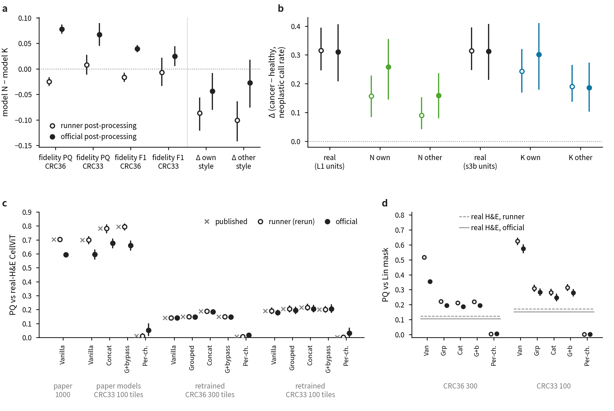

# 結果：用 CellViT 原作者的後處理重算 stage-3 的 K／N 判讀和 hfv 論文 Fig 2 的 PQ（2026-11-22）

預先登記：`PREREG.md`（f993b57，§5 在 449d522；兩者都在對應的新數字出現之前 push）。程式：`stages/run_cellvit_local.py` 新增 `--postprocess official`（467a54f，預設仍是 runner，舊數字照樣可重現）。

## 一句話

- **stage-3（D2）：判讀列不變，仍是第 2 列「保留 K」。** 但理由變窄了：舊結果是兩個 Δ 區間都整段在 0 以下；換成 official 後只剩「N 自己風格」那一個（NP − KP = −0.044 [−0.080, −0.008]），「另一風格」那個區間跨過 0；而且四個忠實度區間全部翻成 N 比較好（> 0）。如果沒有 Δ 那一條，規則會落到第 1 列（換成 N）。
- **順帶（不改本文件的判讀，但需要使用者知道）：app 8 的判讀列從第 1 列（換成 K）變成第 2 列。** 在 official 後處理下，舊模型 C 本身也分得出癌／健康（CP 的 Δ 從 0.035 變 0.241），K 比 C 多出來的 Δ 不再整段大於 0。當初 sim2real 從 C 換到 K 就是依據 app 8 這一列。
- **Fig 2：論文舊模型那一組的主要 PQ 全部下降約 0.10–0.13**（Vanilla 0.7035 → 0.593，Concat 0.782 → 0.677，Grouped + bypass 0.794 → 0.661）；Concat、Grouped + bypass 仍高於 Vanilla，但這兩者的先後對調了。重訓組的主要 PQ 幾乎不變；Lin 遮罩的次要 PQ 下降，Vanilla 降最多（CRC36 0.518 → 0.356）。

**圖。** 空心 = runner 後處理（hfv 管線一直以來用的），實心 = official 後處理（CellViT 原作者的 `cell_detection.py`）。誤差線 = 95 % 區間。
**a** stage-3 判讀用到的六個區間（N − K）。左四個：忠實度（生成圖的 PQ／F1 減去真實 H&E 的同一個量，見 §1），圖塊 bootstrap 10,000 次、seed 42。右兩個：Δ 的 N − K（Δ 定義見 §1），用原規則的 12 視窗 bootstrap（2,000 次、seed 20261128）。
**b** 讀數 3 每一組的 Δ。黑 = 真實 H&E（兩種單位清單），綠 = N，藍 = K；「own／other」= 生成時用該模型自己的風格參考圖／另一張的。
**c** Fig 2 的主要 PQ（參考 = 真實 H&E 的 CellViT 核，照論文先二值化）。× = 論文或 README 公布的數。
**d** 重訓組的次要 PQ（參考 = Lin 的螢光核遮罩）。虛線／實線 = 真實 H&E 自己對 Lin 遮罩的 PQ（參考線），runner／official。

## 1. 名詞

- **runner 後處理**：hfv 的 `run_cellvit_local.py` 原本的作法。CellViT 輸出「這個像素是不是核」的機率圖，runner 取 ≥ 0.5 的像素、做一次 3×3 開運算、把每個外輪廓當成一個核。**不會把黏在一起的核切開**；正規化用 ImageNet 的平均／標準差，和模型訓練時（0.5／0.5）不同。
- **official 後處理**：CellViT 原作者的流程。正規化照模型設定檔（0.5／0.5），再用 HoVer-Net 的水平／垂直距離圖做分水嶺，**把黏在一起的核切開**；類型 = 核內每個像素類型預測的多數決。
- **K、N**：stage-3 比較的兩個重訓 PixCell 模型（hfv_retrain2），差別只在訓練時輸入的核遮罩畫法：K 用 R0（Lin 螢光核分割直接畫成的遮罩，即評估包的 `cell_masks`）；N 用 L1（和 H&E 上看得到的核一致的「真實核」遮罩）。C = 更早的 Concat 模型（舊的輸入遮罩）。
- **忠實度（fidelity）**：同一張圖塊，生成圖的 CellViT 核對輸入遮罩的 PQ（或 F1），減去真實 H&E 的 CellViT 核對同一張遮罩的 PQ（或 F1）。> 0 = 生成圖比真實組織更貼遮罩。
- **Δ（讀數 3）**：在 CRC16 的 12 個視窗裡，CellViT 把核判成「腫瘤（neoplastic）」的比例，癌視窗減健康視窗。真實 H&E 約 0.31；生成圖的 Δ 越接近真實越好，N − K < 0 代表 N 的癌／健康區分比 K 弱。
- **PQ（panoptic quality）**：一個核配對到參考核的條件是 IoU ≥ 0.5；PQ = 配對核的平均 IoU × 配對比例（F1）。

## 2. 閘門（全部通過）

| 閘門 | 結果 |
|---|---|
| 預設路徑不變：runner 重跑和舊 JSON 逐檔相同 | 32／32 相同（煙霧測試） |
| official 實例圖 = 前一份實驗 `cellvit_samh_20261122` 的 official CellViT-256 | RAW 192、KP 384、NP 384 張逐像素相同 |
| stage-3 與 CellViT 無關的欄位（LPIPS、HED、遮罩核數）和 FUD | 逐張相同；FUD 相同 |
| app 8 的 K 端（r2_app8 內建閘門） | 通過（K 端 = official 的 results_app8 逐視窗計數） |
| Fig 2 重訓組真實 H&E = stage-3 的 R 圖 | CRC36 300、CRC33 100 張逐像素相同 |
| 重訓 Concat 的 runner 次要 PQ = stage-3 的 `pq2_K` | 300／300、100／100 逐張相同（最大差 0） |
| 上傳的 15 個 zip 的 sha256 | 全部相符 |

## 3. stage-3：K 還是 N（PREREG §5，§9.5 原樣套用）

### 3.1 判讀用的六個區間

| 區間（N − K） | runner（舊） | official（新） |
|---|---|---|
| 忠實度 PQ，CRC36 | −0.025 [−0.034, −0.017] | **+0.078 [0.069, 0.087]** |
| 忠實度 F1，CRC36 | −0.017 [−0.026, −0.008] | **+0.040 [0.033, 0.047]** |
| 忠實度 PQ，CRC33 | +0.008 [−0.012, 0.027] | **+0.067 [0.045, 0.089]** |
| 忠實度 F1，CRC33 | −0.007 [−0.033, 0.022] | **+0.025 [0.005, 0.044]** |
| Δ，NP − KP（自己的風格） | −0.086 [−0.121, −0.056] | **−0.044 [−0.080, −0.008]** |
| Δ，ND − KD（另一風格） | −0.101 [−0.142, −0.063] | −0.028 [−0.076, 0.018] |
| **判讀列** | **2：保留 K** | **2：保留 K（不變）** |

規則的順序是先看第 2 列（任一 Δ 區間整段 < 0 → 保留 K），所以新結果仍落在第 2 列，只靠 NP − KP 一個區間（上界 −0.008）。換成 10,000 次、seed 42 的視窗 bootstrap（敏感度分析）：NP − KP = −0.044 [−0.079, −0.009]、ND − KD = −0.028 [−0.075, 0.017]，判讀相同。

### 3.2 讀數 1 的其他量（平均；N − K 區間）

| 組 | 量 | runner N／K | official N／K | official N − K |
|---|---|---|---|---|
| CRC36 | PQ 對輸入遮罩 | 0.249／0.211 | 0.401／0.187 | +0.214 [0.206, 0.222] |
| CRC36 | 真實 H&E 對同一遮罩（參考） | 0.185／0.122 | 0.243／0.106 | |
| CRC36 | F1 對真實 H&E 核 | 0.504／0.521 | 0.789／0.750 | +0.040 [0.033, 0.047] |
| CRC36 | 每張核數 | 37.5／38.5 | 62.0／59.1 | +2.8 [2.2, 3.4] |
| CRC33 | PQ 對輸入遮罩 | 0.436／0.282 | 0.472／0.247 | +0.225 [0.202, 0.247] |
| CRC33 | 真實 H&E 對同一遮罩（參考） | 0.317／0.171 | 0.311／0.153 | |
| CRC33 | F1 對真實 H&E 核 | 0.731／0.738 | 0.826／0.801 | +0.025 [0.005, 0.044] |

（K 和 N 的輸入遮罩不同，所以「參考」那一列兩個模型各有一個值。真實 H&E 每張核數：CRC36 runner 38.5 → official 54.0；Lin 遮罩 45.7。LPIPS、HED、FUD 和 CellViT 無關，新舊相同。）

### 3.3 讀數 3（CRC16 12 個視窗）

| 組 | Δ runner | Δ official | 癌視窗腫瘤比例 runner → official | 每張核數 runner → official |
|---|---|---|---|---|
| 真實（L1 單位） | 0.316 [0.247, 0.395] | 0.310 [0.208, 0.407] | 0.566 → 0.766 | 38.7 → 52.7 |
| N own（NP） | 0.157 [0.083, 0.228] | 0.258 [0.145, 0.355] | 0.349 → 0.673 | 45.5 → 64.6 |
| N other（ND） | 0.090 [0.042, 0.153] | 0.159 [0.079, 0.237] | 0.320 → 0.652 | 45.4 → 63.5 |
| 真實（s3b 單位） | 0.314 [0.247, 0.396] | 0.313 [0.213, 0.408] | 0.565 → 0.769 | 38.7 → 52.7 |
| K own（KP） | 0.243 [0.169, 0.320] | 0.302 [0.179, 0.410] | 0.436 → 0.739 | 45.0 → 59.4 |
| K other（KD） | 0.190 [0.137, 0.265] | 0.186 [0.102, 0.273] | 0.429 → 0.723 | 44.9 → 58.9 |

真實 − 生成的 Δ 差（描述）：真實 − NP 0.159 → 0.052 [0.007, 0.116]；真實 − KP 0.071 → 0.011 [−0.033, 0.059]。也就是 official 下 K 的 Δ 和真實分不開，N 仍略低。official 把真實與生成圖的「腫瘤」比例都拉高約 0.2–0.3（癌、健康視窗一起升），Δ 本身在真實 H&E 上不變。

### 3.4 順帶：app 8 的判讀列（只並列，不在這裡重新解讀）

| app 8 主要量 | runner（舊） | official（新） |
|---|---|---|
| KP − CP：Δ | 0.209 [0.149, 0.266] | 0.060 [−0.035, 0.148] |
| KP − CP：癌視窗腫瘤比例 | 0.147 [0.094, 0.198] | 0.222 [0.165, 0.285] |
| KD − CD：Δ | 0.178 [0.128, 0.228] | −0.007 [−0.084, 0.065] |
| KD − CD：癌視窗腫瘤比例 | 0.133 [0.077, 0.184] | 0.227 [0.168, 0.288] |
| **app 8 判讀列** | **1：四個都 > 0 → 換成 K** | **2：有 Δ 區間跨 0 → 只靠標籤定義不夠，不依 app 8 換** |

原因在 C：CP 的 Δ 從 0.035 變 0.241、CD 從 0.012 變 0.194（C 的每張核數 45 → 80，official 把 C 圖上黏成一團的核切開後，C 也分得出癌／健康）。K 在「癌視窗腫瘤比例」上仍整段高於 C，但在 Δ 上不再。這會影響當初「sim2real 從 C 換到 K」的依據；是否回頭重議是使用者的決定。

## 4. hfv 論文 Fig 2 的 PQ（PREREG §5）

### 4.1 主要 PQ（參考 = 真實 H&E 的 CellViT 核，二值化後取連通區塊；論文的定義）

| 組 | 變體 | 公布 | runner 重跑 | official | official − runner |
|---|---|---|---|---|---|
| 論文 1,000 張 | Vanilla | 0.7035 | 0.7035 [0.696, 0.711] | 0.593 [0.584, 0.602] | −0.110 [−0.120, −0.100] |
| 論文 100 張 | Vanilla | 0.6987 | 0.699 [0.668, 0.726] | 0.597 [0.559, 0.631] | −0.102 [−0.133, −0.068] |
| 論文 100 張 | Concat | 0.7817 | 0.782 [0.746, 0.811] | 0.677 [0.640, 0.710] | −0.105 [−0.139, −0.065] |
| 論文 100 張 | Grouped + bypass | 0.7943 | 0.794 [0.768, 0.816] | 0.661 [0.622, 0.696] | −0.133 [−0.166, −0.098] |
| 論文 100 張 | Per-channel | 0.0106 | 0.011 [0.000, 0.031] | 0.051 [0.011, 0.101] | +0.040 [0.010, 0.081] |
| 論文 | Grouped（production） | 0.5694 | 不能重算（原圖已被覆蓋，見 PREREG §5.2） | | |
| 重訓 CRC36 300 | Vanilla | 0.142 | 0.142 [0.135, 0.148] | 0.140 [0.132, 0.149] | −0.001 [−0.008, 0.008] |
| 重訓 CRC36 300 | Grouped | 0.149 | 0.149 [0.140, 0.159] | 0.148 [0.139, 0.159] | −0.001 [−0.008, 0.008] |
| 重訓 CRC36 300 | Concat | 0.189 | 0.189 [0.179, 0.199] | 0.185 [0.175, 0.197] | −0.004 [−0.011, 0.006] |
| 重訓 CRC36 300 | Grouped + bypass | 0.148 | 0.148 [0.140, 0.158] | 0.146 [0.137, 0.158] | −0.002 [−0.009, 0.007] |
| 重訓 CRC36 300 | Per-channel | 0.006 | 0.006 [0.005, 0.007] | 0.016 [0.009, 0.026] | +0.010 [0.003, 0.020] |
| 重訓 CRC33 100 | Vanilla | 0.190 | 0.190 [0.167, 0.214] | 0.178 [0.157, 0.200] | −0.012 [−0.024, −0.001] |
| 重訓 CRC33 100 | Grouped | 0.204 | 0.204 [0.180, 0.229] | 0.194 [0.168, 0.222] | −0.010 [−0.029, 0.016] |
| 重訓 CRC33 100 | Concat | 0.216 | 0.216 [0.192, 0.241] | 0.206 [0.180, 0.233] | −0.011 [−0.031, 0.016] |
| 重訓 CRC33 100 | Grouped + bypass | 0.201 | 0.201 [0.177, 0.225] | 0.205 [0.176, 0.238] | +0.004 [−0.021, 0.037] |
| 重訓 CRC33 100 | Per-channel | 0.002 | 0.002 [0.001, 0.004] | 0.032 [0.002, 0.071] | +0.030 [−0.000, 0.069] |

**變體 − Vanilla（配對，論文 100 張）：** Concat runner +0.083 [0.050, 0.113]、official +0.080 [0.059, 0.106]；Grouped + bypass runner +0.096 [0.061, 0.131]、official +0.064 [0.050, 0.079]；Per-channel runner −0.688、official −0.546（兩條路徑都整段 < 0）。所以「Concat、Grouped + bypass 比 Vanilla 高、Per-channel 遠低」在兩條路徑下都成立。

**Grouped + bypass − Concat（不在預先登記內，補充）：** runner +0.013 [−0.004, 0.038]，official −0.016 [−0.041, −0.000]。論文寫的「Grouped + bypass 最高」在 official 下不成立（兩者很接近，official 下 Concat 略高）。

**不二值化的版本（`pq_inst`）：** 論文組和 `pq_main` 至多差 0.013；重訓 CRC36 組 official 的 `pq_inst` 比 `pq_main` 高 0.013–0.024（二值化會把 official 切開但相碰的真實核重新連在一起）。重訓組的變體 − Vanilla 結論在兩種版本下相同（見 `data/stats.json`）。

### 4.2 次要 PQ（參考 = Lin 遮罩）與參考線

| 組 | 變體 | runner 重跑（= README） | official | official − runner |
|---|---|---|---|---|
| CRC36 300 | Vanilla | 0.518 [0.507, 0.529] | 0.356 [0.343, 0.368] | −0.162 [−0.171, −0.154] |
| CRC36 300 | Grouped | 0.220 [0.212, 0.229] | 0.194 [0.185, 0.203] | −0.027 [−0.032, −0.021] |
| CRC36 300 | Concat | 0.211 [0.202, 0.220] | 0.187 [0.178, 0.196] | −0.024 [−0.029, −0.019] |
| CRC36 300 | Grouped + bypass | 0.219 [0.211, 0.228] | 0.194 [0.185, 0.203] | −0.026 [−0.031, −0.020] |
| CRC36 300 | Per-channel | 0.003 | 0.005 | +0.002 [0.001, 0.002] |
| CRC36 300 | **真實 H&E（參考線）** | 0.122 [0.116, 0.130] | 0.106 [0.101, 0.112] | −0.016 [−0.021, −0.012] |
| CRC33 100 | Vanilla | 0.624 [0.598, 0.648] | 0.575 [0.544, 0.603] | −0.049 [−0.068, −0.030] |
| CRC33 100 | Grouped | 0.309 [0.284, 0.333] | 0.283 [0.257, 0.309] | −0.025 [−0.038, −0.013] |
| CRC33 100 | Concat | 0.282 [0.257, 0.307] | 0.247 [0.222, 0.273] | −0.035 [−0.048, −0.023] |
| CRC33 100 | Grouped + bypass | 0.314 [0.291, 0.338] | 0.280 [0.254, 0.305] | −0.034 [−0.047, −0.022] |
| CRC33 100 | Per-channel | 0.001 | 0.001 | −0.000 [−0.001, 0.000] |
| CRC33 100 | **真實 H&E（參考線）** | 0.172 [0.149, 0.194] | 0.153 [0.132, 0.175] | −0.019 [−0.030, −0.008] |

除 Per-channel 外，所有變體在兩條路徑下都高於真實 H&E 的參考線；Vanilla 仍最高，但 CRC36 上比其他變體高出的量從約 0.30 縮到約 0.16。

### 4.3 重現檢查（不是門檻）

- runner 重跑的平均值和公布值的差：論文 1,000 張 −0.00003；論文 100 張 −0.0002 到 0.0000；重訓組 0。
- 逐張相同的比例：論文 100 張 42–99／100（公布值是 Colab GPU 跑的，這裡是 Hyak CPU，少數邊界上的核會進出，平均值不受影響）；重訓組主要 PQ 298–300／300、100／100，次要 PQ 全部相同。
- 所以「新舊差」來自後處理，不是機器或程式版本。

## 5. 工作與時間（Hyak cheme，8 CPU／工作）

| 工作 | Job ID | 量測時間 |
|---|---|---|
| 煙霧測試 official／runner（32 張） | 43465715／43465716 | 1:27／0:51 |
| stage-3 official 推論（14 個陣列任務：RAW、CP、CD、KP、KD、KE、NP、ND、{N,K,R}×2 組） | 43465769 | 每任務 2:56–9:00，合計 1:43:54 |
| app8_stats + r2_app8（official 決策 CI + 兩條路徑的 10k 敏感度） | 43465770 | 5:15 |
| 讀數 1（G′ 上的 s3metrics） | 43465771 | 12:27 |
| Fig 2 official 推論（15 個 zip，4,300 張） | 43465957 | 每任務 2:04–20:27，合計 1:42:53（約 1.4 s／張） |
| Fig 2 runner 重跑（同 4,300 張） | 43465958 | 每任務 1:02–9:00，合計 42:03（約 0.6 s／張） |
| Fig 2 PQ 計算（cvo_fig2.py） | 43465963 | 8:56 |

全程 CPU，沒有用 GPU（量測時間不需要）。

## 6. 偏離預先登記

1. **stage-3 推論在 §5 寫好之前就開始**：PREREG 開頭已註明；§5 在任何 Fig 2 影像的新 CellViT 結果之前 push（449d522）。
2. **Fig 2 PQ 計算的第一次 sbatch 被拒**（`Job dependency problem`：相依清單包含已結束的 43465769）。沒有執行；改成只相依 43465957／43465958 後送出（43465963），腳本本身沒改。
3. **Grouped（production）不重算**：原圖已被覆蓋（PREREG §5.2 已寫明），照規則不重新生成。
4. **補充一個未預先登記的比較**：Grouped + bypass − Concat（§4.1），因為兩者的先後在 official 下對調；標為補充，不作規則。
5. **「Concat runner 次要 PQ = stage-3 `pq2_K`」閘門**在本機 `cvo_stats.py` 裡檢查，不在 Hyak 的 cvo_fig2.py 裡；結果逐張相同。
6. 上傳 Fig 2 影像的指令超過前景時限，轉到背景完成（sha256 全部相符）；不影響結果。

## 7. 檔案

- `scripts/`：`cvo_infer.slurm`、`cvo_stage3.slurm`、`cvo_r2app8_b10k.py`、`cvo_r1.slurm`、`cvo_fig2.py`、`cvo_fig2.slurm`、`cvo_stats.py`（本機統計 → `data/stats.json`）、`cvo_fig.py`（圖）。
- `data/stage3/`：新的 `stats_r1.json`、`decision.json`、`tiles_*.csv`、`fud.json`、`r2_app8_official.json`、`results_app8_official.json`、兩條路徑的 `r2_app8_*_b10k.json`；舊的 `old_tiles_*.csv`、`results_app8_runner.json`（閘門用）。
- `data/fig2/`：`tiles_{P,36,33}.csv`（每張圖塊、每變體、兩條路徑）、`cvo_fig2.log`、`zips_manifest.json`、`pub/`（公布的逐張值）。
- `data/stats.json`：本文所有數字。
- Hyak：`/gscratch/cheme/chiu/cellvit_official_20261122/`（`RUN.txt` 記 job ID）。
