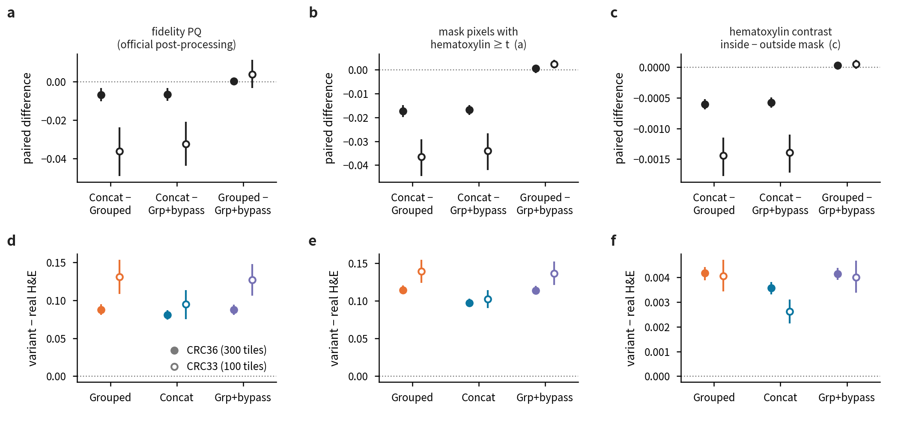

# 結果：Grouped 類變體比 Concat 更照輸入遮罩畫嗎？（重訓 1 的 Fig 2 影像，2026-11-22）

預先登記：`PREREG.md`（f13d239，寫法修訂 1d5ede3，兩者都在任何數字之前 push）。只讀現有影像和現有 CellViT 結果：沒有生成、沒有訓練、沒有重跑 CellViT、沒有改 PixCell。

## 一句話

- **規則結果 A：「a Grouped variant follows masks better」**，Grouped 和 Grouped + bypass **兩個都成立**：在 CRC36 和 CRC33 上，照遮罩畫的 PQ（官方後處理）、(a)、(c) 三個量的「Concat − G」區間全部整段在 0 以下（6／6 個區間，兩個 G 都是）。
- **但差距小**：CRC36 上 Concat 比 Grouped 少的量，只佔 Grouped「高出真實 H&E 參考線」那段的約 8 %（PQ）到 15 %（(a)）；CRC33 約 26–35 %。三個重訓變體都明顯比真實 H&E 更貼遮罩，Concat 也是。
- 描述量方向一致：只看排序、不受整體深淺影響的 AUC 也偏向 Grouped，所以差別不是「Grouped 整張染得比較深」造成的。Grouped 和 Grouped + bypass 之間分不出來。
- **換的代價**：Concat 在所有外觀量上都比兩個 Grouped 好（FUD、LPIPS、style_hed），也更依賴 TME 通道；sim2real 的應用全部在 Concat 上跑過。**要不要換生成器、要不要重訓，是使用者的決定**；本實驗只回報。

**圖。** 重訓 1 的 Fig 2 影像（輸入遮罩 = 形狀庫遮罩）。實心 = CRC36 保留區 300 張，空心 = CRC33 次要組 100 張；誤差線 = 95 % 圖塊 bootstrap 區間（10,000 次，seed 42，每張切片一個抽樣矩陣、所有量共用）。
**a–c** 變體之間的配對差（同一張圖塊、同一張遮罩）：**a** 照遮罩畫的 PQ（CellViT 官方後處理）；**b** (a) 遮罩像素中 hematoxylin ≥ t 的比例；**c** (c) 遮罩內減遮罩外的平均 hematoxylin。< 0 = 左邊的變體比較不照遮罩畫。
**d–f** 同三個量，各變體減去真實 H&E 對同一張遮罩的值（參考線）。> 0 = 比真實組織更貼遮罩。PixCell 原版不畫在圖上（它的值大很多，會把軸壓扁），數字在 §5。

## 1. 名詞（詳見 PREREG §1）

- **四個重訓變體**都是 PixCell ControlNet，差別在 TME 通道怎麼接進去：
  - **Concat**：遮罩和 9 個 TME 通道以原解析度疊起來直接送進 ControlNet。**sim2real 目前用的形狀庫遮罩生成器就是這個 Concat**（決定 D2）。
  - **Grouped**：TME 通道分四組，各自編碼後用 cross-attention（以遮罩 latent 當 query）算出修正量再相加；遮罩 latent 本身不直接送進去。
  - **Grouped + bypass**：同 Grouped，但遮罩 latent 也直接加進去（直通路徑）。
  - **Per-channel**：每個通道一個編碼器。
  - **PixCell 原版**：只有遮罩和 UNI，沒有 TME 通道，沒有重訓（描述用）。
- **輸入遮罩**：形狀庫遮罩（Lin 細胞位置 + 形狀庫輪廓），不是 Lin 寬鬆核形。結論只適用於這個遮罩條件。
- **照遮罩畫的 PQ**：生成圖上 CellViT 找到的核，和它自己的輸入遮罩用 IoU ≥ 0.5 一對一配對；PQ = 配對核的平均 IoU × 偵測 F1。CellViT 的「官方後處理」會用 HV 距離圖把相碰的核切開，「hfv 舊後處理」不會。規則用官方後處理。每張圖塊的值沿用上一份實驗（`cellvit_official_20261122/data/fig2/tiles_{36,33}.csv`），本實驗只算配對差。
- **hematoxylin 讀數**（不經過任何分割器）：把影像做顏色反卷積，得到每個像素的 hematoxylin 光學密度（越大越像被蘇木素染成藍紫色的核）。對同一張遮罩：
  - **(a)** 遮罩像素中 hematoxylin ≥ t 的比例 —「遮罩說有核的地方，圖上真的畫了核嗎」；
  - **(b)** hematoxylin ≥ t 的像素中落在遮罩內的比例 —「圖上畫的核是不是都在遮罩說的位置」（描述）；
  - **(c)** 遮罩內平均 hematoxylin − 遮罩外平均（不需要門檻）；
  - **AUC**（描述）：遮罩內隨機一個像素的 hematoxylin 大於遮罩外隨機一個像素的機率。只看排序，整張圖統一變深或變淺不會改變它。
  - t = 0.0224：stage-1 D2 的 Youden 規則在 CRC16 真實 H&E 上算出的門檻（使「真核判對率 − 空位判錯率」最大）。
- **參考線**：真實 H&E 對同一張遮罩的同一個量。遮罩來自螢光分割，物件定義和 H&E 上看到的核不同，所以真實組織本身也不完全貼合（參考線不是 1）。

## 2. 閘門

| 閘門 | 結果 |
|---|---|
| 10 個影像 zip 的 sha256 = 上一份實驗的 manifest | 10／10 相同 |
| 每組五個變體的圖塊名稱相同，且等於真實 H&E 的檔名 | CRC36 300、CRC33 100 |
| 輸入遮罩 = 重訓 1 評估包 `evalpack_<set>.tar` 裡的 `cell_masks` | 400／400 張逐像素相同 |
| hematoxylin 程式重現 mask_truenuc 的「真實 H&E 對 Lin 寬鬆核形」(a)(b)(c)（前 8 張 CRC16） | 最大差 0（float32，和 mask_truenuc 同一環境）；float64 讀數和它差 ≤ 2.6e-9 |
| 讀數缺值（空遮罩或沒有 hematoxylin ≥ t 的像素） | 0 張排除 |

## 3. 規則（PREREG §3）

「Concat − G」的 95 % 區間（< 0 = Concat 較不照遮罩畫）：

| 量 | 切片 | Concat − Grouped | Concat − Grouped + bypass | Grouped − Grouped + bypass（描述） |
|---|---|---|---|---|
| 照遮罩畫的 PQ（官方後處理） | CRC36 | **−0.0068 [−0.0103, −0.0034]** | **−0.0067 [−0.0101, −0.0034]** | +0.0001 [−0.0017, +0.0020] |
| | CRC33 | **−0.0362 [−0.0492, −0.0238]** | **−0.0324 [−0.0438, −0.0208]** | +0.0037 [−0.0034, +0.0114] |
| (a) | CRC36 | **−0.0174 [−0.0199, −0.0149]** | **−0.0169 [−0.0189, −0.0148]** | +0.0006 [−0.0013, +0.0017] |
| | CRC33 | **−0.0366 [−0.0447, −0.0292]** | **−0.0341 [−0.0421, −0.0266]** | +0.0025 [+0.0006, +0.0042] |
| (c) | CRC36 | **−0.00061 [−0.00069, −0.00052]** | **−0.00058 [−0.00066, −0.00049]** | +0.00003 [−0.00004, +0.00008] |
| | CRC33 | **−0.00144 [−0.00178, −0.00115]** | **−0.00139 [−0.00172, −0.00110]** | +0.00005 [−0.00002, +0.00012] |
| **成立？** | | **是（6／6）** | **是（6／6）** | |

**結果 A：a Grouped variant follows masks better（Grouped 和 Grouped + bypass 都成立）。**

**差距有多大（描述）：** 拿「Concat − Grouped」和「Grouped − 真實參考線」比，也就是 Concat 少掉的量佔 Grouped 比真實組織多貼遮罩那一段的比例（Grouped + bypass 幾乎相同：8 %、15 %、14 %／26 %、25 %、35 %）：

| 量 | CRC36 | CRC33 |
|---|---|---|
| 照遮罩畫的 PQ | 0.0068 ／ 0.0874 ≈ 8 % | 0.0362 ／ 0.1307 ≈ 28 % |
| (a) | 0.0174 ／ 0.1146 ≈ 15 % | 0.0366 ／ 0.1391 ≈ 26 % |
| (c) | 0.00061 ／ 0.00417 ≈ 15 % | 0.00144 ／ 0.00406 ≈ 35 % |

也就是：Concat 仍然明顯比真實 H&E 更貼遮罩（§4 的「變體 − 真實」全部整段 > 0），只是比兩個 Grouped 少一些；CRC33（訓練用的切片、100 張）上的差距比 CRC36（保留區、300 張）大。

## 4. 完整表格

### 4.1 每臂平均（同一張遮罩）

| 切片 | 量 | 真實 H&E | PixCell 原版 | Grouped | Concat | Grouped + bypass | Per-channel |
|---|---|---|---|---|---|---|---|
| CRC36 | 照遮罩畫的 PQ（官方） | 0.106 | 0.356 | 0.194 | 0.187 | 0.194 | 0.005 |
| | 照遮罩畫的 PQ（hfv 舊） | 0.122 | 0.518 | 0.220 | 0.211 | 0.219 | 0.003 |
| | (a) | 0.664 | 0.985 | 0.779 | 0.762 | 0.778 | 0.365 |
| | (b) | 0.622 | 0.478 | 0.687 | 0.685 | 0.687 | 0.292 |
| | (c) | 0.0154 | 0.0352 | 0.0195 | 0.0189 | 0.0195 | −0.0028 |
| | AUC | 0.782 | 0.958 | 0.854 | 0.845 | 0.853 | 0.447 |
| | 整張平均 hematoxylin | 0.0212 | 0.0366 | 0.0229 | 0.0226 | 0.0229 | 0.0236 |
| CRC33 | 照遮罩畫的 PQ（官方） | 0.153 | 0.575 | 0.283 | 0.247 | 0.280 | 0.001 |
| | 照遮罩畫的 PQ（hfv 舊） | 0.172 | 0.624 | 0.309 | 0.282 | 0.314 | 0.001 |
| | (a) | 0.513 | 0.945 | 0.652 | 0.616 | 0.650 | 0.103 |
| | (b) | 0.483 | 0.475 | 0.596 | 0.583 | 0.596 | 0.072 |
| | (c) | 0.0141 | 0.0299 | 0.0182 | 0.0168 | 0.0181 | −0.0015 |
| | AUC | 0.794 | 0.974 | 0.873 | 0.856 | 0.871 | 0.463 |
| | 整張平均 hematoxylin | 0.0134 | 0.0207 | 0.0141 | 0.0139 | 0.0141 | 0.0152 |

（照遮罩畫的 PQ 的平均和上一份實驗 §4.2 相同；所有區間在 `data/stats.json`。）

### 4.2 變體 − 真實 H&E 參考線（規則的三個量）

| 切片 | 量 | Grouped | Concat | Grouped + bypass | Per-channel |
|---|---|---|---|---|---|
| CRC36 | 照遮罩畫的 PQ | +0.087 [+0.081, +0.095] | +0.081 [+0.074, +0.087] | +0.087 [+0.081, +0.094] | −0.102 [−0.108, −0.096] |
| | (a) | +0.115 [+0.109, +0.121] | +0.097 [+0.092, +0.103] | +0.114 [+0.109, +0.120] | −0.300 [−0.314, −0.285] |
| | (c) | +0.0042 [+0.0039, +0.0044] | +0.0036 [+0.0033, +0.0038] | +0.0041 [+0.0039, +0.0044] | −0.0181 [−0.0186, −0.0177] |
| CRC33 | 照遮罩畫的 PQ | +0.131 [+0.108, +0.154] | +0.095 [+0.075, +0.113] | +0.127 [+0.106, +0.148] | −0.152 [−0.174, −0.131] |
| | (a) | +0.139 [+0.124, +0.155] | +0.103 [+0.091, +0.115] | +0.137 [+0.121, +0.152] | −0.411 [−0.429, −0.392] |
| | (c) | +0.0041 [+0.0034, +0.0047] | +0.0026 [+0.0021, +0.0031] | +0.0040 [+0.0034, +0.0047] | −0.0156 [−0.0163, −0.0150] |

## 5. 描述量（不進規則）

| 量 | 切片 | Concat − Grouped | Concat − Grouped + bypass |
|---|---|---|---|
| 照遮罩畫的 PQ（hfv 舊後處理） | CRC36 | −0.0094 [−0.0148, −0.0039] | −0.0082 [−0.0134, −0.0030] |
| | CRC33 | −0.0268 [−0.0396, −0.0141] | −0.0320 [−0.0451, −0.0188] |
| (b) | CRC36 | −0.0023 [−0.0043, −0.0005] | −0.0024 [−0.0043, −0.0006] |
| | CRC33 | −0.0127 [−0.0196, −0.0058] | −0.0129 [−0.0194, −0.0067] |
| AUC | CRC36 | −0.0093 [−0.0108, −0.0078] | −0.0086 [−0.0100, −0.0071] |
| | CRC33 | −0.0166 [−0.0217, −0.0118] | −0.0155 [−0.0204, −0.0108] |
| 整張平均 hematoxylin | CRC36 | −0.0003 [−0.0003, −0.0002] | −0.0003 [−0.0003, −0.0002] |
| | CRC33 | −0.0002 [−0.0003, −0.0001] | −0.0002 [−0.0003, −0.0002] |
| (a)，各切片自己的 stage-1 t | CRC36 | −0.0168 [−0.0192, −0.0142] | −0.0162 [−0.0182, −0.0142] |
| | CRC33 | −0.0330 [−0.0415, −0.0250] | −0.0310 [−0.0394, −0.0230] |
| (b)，各切片自己的 stage-1 t | CRC36 | −0.0024 [−0.0043, −0.0005] | −0.0023 [−0.0041, −0.0005] |
| | CRC33 | −0.0090 [−0.0152, −0.0028] | −0.0090 [−0.0148, −0.0035] |

怎麼讀：
- **差別不是「整體染色深淺」造成的。** Concat 整張圖確實比 Grouped 淡一點（平均 hematoxylin −0.0002 到 −0.0003），單看 (a) 可能是這個原因；但 AUC 只看排序、不受整體深淺影響，也偏向 Grouped，(b)（染色是否落在遮罩內）也偏向 Grouped。所以 Grouped 的核位置確實更對得上遮罩。
- hfv 舊後處理的 PQ、換門檻的 (a)(b) 方向都一樣，結論不依賴後處理或門檻。
- Grouped 和 Grouped + bypass 幾乎一樣：只有 CRC33 的 (a)（+0.0025 [+0.0006, +0.0042]）和 CRC36 的 AUC（+0.0007 [+0.0004, +0.0010]）偏向 Grouped，量很小。

### PixCell 原版（協調者追加，描述，不進規則）

| 量 | 切片 | 原版 − 真實 | 原版 − Concat | 原版 − Grouped | 原版 − Grouped + bypass |
|---|---|---|---|---|---|
| 照遮罩畫的 PQ（官方） | CRC36 | +0.249 [+0.239, +0.260] | +0.169 [+0.161, +0.176] | +0.162 [+0.154, +0.170] | +0.162 [+0.154, +0.170] |
| | CRC33 | +0.422 [+0.394, +0.451] | +0.328 [+0.301, +0.354] | +0.292 [+0.267, +0.317] | +0.295 [+0.271, +0.320] |
| 照遮罩畫的 PQ（hfv 舊） | CRC36 | +0.395 [+0.384, +0.406] | +0.307 [+0.299, +0.315] | +0.297 [+0.290, +0.305] | +0.299 [+0.291, +0.306] |
| | CRC33 | +0.453 [+0.426, +0.480] | +0.342 [+0.316, +0.368] | +0.316 [+0.293, +0.338] | +0.310 [+0.288, +0.332] |
| (a) | CRC36 | +0.321 [+0.314, +0.327] | +0.224 [+0.218, +0.229] | +0.206 [+0.200, +0.212] | +0.207 [+0.201, +0.212] |
| | CRC33 | +0.432 [+0.415, +0.448] | +0.329 [+0.314, +0.344] | +0.293 [+0.278, +0.307] | +0.295 [+0.281, +0.309] |
| (b) | CRC36 | −0.144 [−0.151, −0.137] | −0.206 [−0.215, −0.198] | −0.209 [−0.217, −0.201] | −0.209 [−0.217, −0.201] |
| | CRC33 | −0.008 [−0.030, +0.014] | −0.108 [−0.132, −0.084] | −0.120 [−0.145, −0.096] | −0.121 [−0.145, −0.097] |
| (c) | CRC36 | +0.0198 [+0.0193, +0.0203] | +0.0162 [+0.0158, +0.0168] | +0.0156 [+0.0152, +0.0162] | +0.0157 [+0.0152, +0.0162] |
| | CRC33 | +0.0158 [+0.0144, +0.0174] | +0.0132 [+0.0119, +0.0146] | +0.0117 [+0.0106, +0.0130] | +0.0118 [+0.0106, +0.0131] |

- PixCell 原版在照遮罩畫的 PQ、(a)、(c)、AUC 上都遠高於所有重訓變體和真實 H&E：它只收到遮罩，於是幾乎完全照遮罩畫核。
- 但它的 (b) 比重訓變體低、在 CRC36 上甚至比真實 H&E 低，整張平均 hematoxylin 也高很多（CRC36 0.037 對真實 0.021）：它整張圖染得很深（遮罩像素 98.5 % 超過門檻），遮罩外也有大量深染像素。這和重訓 1 README 的 style_hed 0.315（重訓變體約 0.04）一致：原版照遮罩畫，但染色風格離真實組織很遠。所以原版的高忠實度不能直接拿來和重訓變體比「誰比較好」。

## 6. 換生成器的代價（結果 A 要求列出）

**外觀量**（重訓 1 README 的 Fig 2 表，同一批圖；`hfv_retrain_20261118/results/stats_lin_fig2_*.json`；越小越像真實 H&E；FUD 是整組一個數，沒有區間）：

| 量 | 切片 | Grouped | Concat | Grouped + bypass |
|---|---|---|---|---|
| FUD | CRC36 ／ CRC33 | 168.0 ／ 192.3 | **154.4 ／ 171.6** | 168.8 ／ 192.0 |
| LPIPS | CRC36 ／ CRC33 | 0.347 ／ 0.404 | **0.327 ／ 0.362** | 0.347 ／ 0.404 |
| style_hed | CRC36 ／ CRC33 | 0.040 ／ 0.042 | **0.036 ／ 0.037** | 0.040 ／ 0.043 |
| 拿掉一組 TME 通道後圖改變多少（程式定義的 ΔLPIPS，越大 = 越依賴 TME 通道） | CRC36 ／ CRC33 | 0.032 ／ 0.041 | **0.053 ／ 0.077** | 0.007 ／ 0.012 |

- Concat 在每個外觀量上都比兩個 Grouped 好，而且最依賴 TME 通道（sim2real 要用模擬出的 TME 通道去控制生成圖，這一點和用途直接相關）。Grouped + bypass 幾乎不看 TME 通道（拿掉後圖只變 0.007）。
- README 只有各變體對 PixCell 原版的配對區間，沒有算 Concat − Grouped 的外觀配對差；這裡沒有補算（不在預先登記內）。

**sim2real 的應用全部在 Concat 上跑過**（形狀庫遮罩生成器，或更早的 CellViT 遮罩生成器）：
- apps 1–6（在形狀庫遮罩生成器上重跑過，判讀和 CellViT 遮罩生成器相同）、app 8（癌／健康區分，當初從 CellViT 遮罩生成器換到形狀庫遮罩生成器的依據）、stage 3（形狀庫遮罩生成器 對 真實核形 + 模擬血管生成器，兩者都是 Concat）。換成 Grouped 類，這些判讀都要在新生成器上重跑才能沿用。
- 重訓 2（真實核形 + 模擬血管）只訓練了 Concat；沒有 Grouped 版的重訓 2。換架構等於回到重訓 1 的遮罩和通道，或要另做一次 Grouped 重訓。

**換生成器、重訓，都是使用者的決定。** 本實驗的結果是：照遮罩畫的程度 Grouped 類確實較高，但差距小（佔「高出真實組織」那段的 8–35 %），而 Concat 外觀較像真實組織、也較依賴 TME 通道。

## 7. 限制

- 只有形狀庫遮罩下的重訓 1 變體；Lin 寬鬆核形（重訓 2 用的遮罩）下的 Grouped 沒有資料。
- 每張圖塊每個變體只有一張生成圖（一個 seed），區間只反映圖塊間的變異。
- CRC33 是訓練切片（次要組），CRC36 是保留區；兩者分開報，沒有合併。
- 論文式 PQ（參考 = 真實 H&E 上 CellViT 的核）照協調者指示不計算：這些生成器收到的是形狀庫遮罩，論文式 PQ 是拿生成圖和它沒被要求畫的東西比，在「是否照輸入遮罩畫」上沒有解釋。

## 8. 工作與時間（Hyak cheme compute，4 CPU）

| 工作 | Job ID | 量測時間 | 結果 |
|---|---|---|---|
| fv_hema（第 1 次，`full`） | 43466429 | 0:32 | STOP：閘門 4（float64 和 mask_truenuc 差 2.6e-9 > 1e-9）；閘門 1–3 通過，沒有算任何讀數 |
| fv_hema（第 2 次，`full2`） | 43466455 | 0:06 | STOP：閘門 4（float32 差 3.7e-9）；沒有算任何讀數 |
| fv_hema（第 3 次，`full3`） | 43466477 | 0:39 | 全部閘門通過；2,400 列讀數 |
| 統計、圖 | 本機 | 幾秒 | `fv_stats.py`、`fv_fig.py` |

## 9. 偏離預先登記

1. **論文式 PQ 不計算**（協調者，寫進 PREREG §1 後才 push，沒有偏離）。
2. **寫法修訂**（協調者的命名規則）：PREREG 在 f13d239 push 後、任何數字出現前改成 TERMINOLOGY 的名稱並加代號對照表（1d5ede3），內容不變。
3. **閘門 4 的兩次 STOP 與修正**：
   - 第 1 次：mask_truenuc 當時對真實 H&E 是用 float32 的 hematoxylin 算 (a)(b)(c)，本腳本用 float64；(a)(b) 完全相同，(c) 差 2.6e-9。改成閘門用 float32 重現、容差不變，讀數本身仍用 float64（和 mask_truenuc 對生成圖的算法相同）。
   - 第 2 次：仍差 3.7e-9。登入節點診斷（3 張圖塊）：mask_truenuc 的 PYTHONPATH 會載入另一版 numpy（2.5.4，環境本身是 2.0.2），float32 加總結果不同。改用 mask_truenuc 相同的 PYTHONPATH 後逐位相同（第 3 次通過，最大差 0）。
   - 每次修改都 commit（392b23c、76d39ed）並換新目錄，沒有原樣重送。兩次 STOP 都在算任何讀數之前。
4. **協調者追加 PixCell 原版的配對差**（原版 − Concat／Grouped／Grouped + bypass）：PREREG 已含「原版 − 真實」，這三個配對差是追加。要求在 Hyak 讀數算完之後、我看到任何數字之前收到（統計程式第一次執行因路徑錯誤失敗、沒有輸出）；標為描述、不進規則。
5. 沒有其他偏離。

## 10. 檔案

- `scripts/`：`fv_hema.py`、`fv_hema.slurm`（Hyak）、`fv_stats.py`（本機統計 + 規則 → `data/stats.json`）、`fv_fig.py`（圖）。
- `data/`：`hema_{36,33}.csv`（每張圖塊 × 每臂一列：a、b、c、敏感度 t 的 a、b、AUC、平均 hematoxylin、遮罩前景比例）、`hema_info.json`（閘門、版本）、`fv_hema-43466477.out`（作業紀錄）、`stats.json`（本文所有數字與規則結果）。
- `figures/fig_fv.{png,pdf}`。
- Hyak：`/gscratch/cheme/chiu/fidelity_variants_20261122/`（`full3/` 是採用的輸出；`full/`、`full2/` 是 STOP 的空目錄）。
