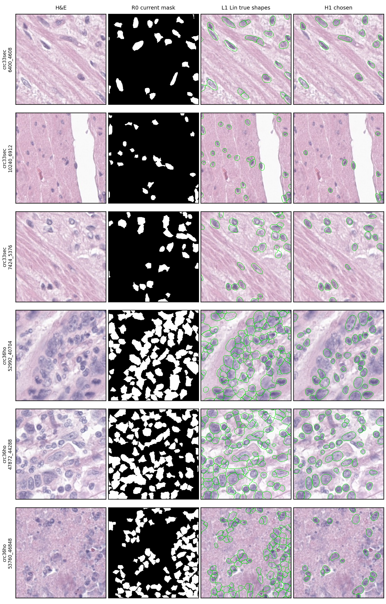

# hfv_retrain2 第 1 階段結果：遮罩來源診斷（2026-11-21）

規則見 `PREREG.md` §2（fe46f3a，修訂 2a7ab03）。

**執行：**
- Hyak cheme 作業：測試 43456841（12 張），正式 43456875（crc33sec）、43456876（crc36ho），每個 2 分 11 秒，16 CPU。
- 程式：`scripts/diag.py`、`scripts/diag.slurm`。
- 數字：`data/diag_stats.json`；每張圖塊的值在 `data/tiles_<set>.csv`。
- 圖塊數：crc33sec 824 張（真實 H&E 1,033 張，其中 5 張沒有評估包遮罩，另有不在 `real.csv` 的不算）；crc36ho 300 張。

**接觸表：**
- 每組 3 張，從細胞數高於中位數的圖塊用 seed 42 抽出。
- 四欄：H&E、現在的訓練遮罩（R0）、Lin 真實形狀（L1）的輪廓、選中的遮罩（H1）的輪廓。

## 1. 診斷

### D1：細胞集合（中心點配對，半徑 = robust.py 的 r）

| | Lin 細胞 | CellViT 配上 | CellViT 多出的偵測 | StarDist 配上 | StarDist 多出的偵測 |
|---|---|---|---|---|---|
| crc33sec | 13,640 | 7,795（57 %） | 1,899 | 6,143（45 %） | 1,248 |
| crc36ho | 20,614 | 7,665（37 %） | 1,561 | 8,439（41 %） | 955 |

兩種 H&E 分割器都只找到 Lin 細胞的 37–57 %。

### D2：兩種分割器都沒配上的 Lin 核，在 H&E 上看不看得到

- 分數是 hematoxylin OD 在 Lin loose 核範圍內的平均。
- Youden 門檻把核和背景分得很開：

  | | 門檻 t | TPR | FPR |
  |---|---|---|---|
  | crc33sec | 0.020 | 0.980 | 0.019 |
  | crc36ho | 0.022 | 0.982 | 0.007 |

- 結果：

  | | 兩種都沒配上（n） | 分數 ≥ t | 修正後（Rogan–Gladen） | 只有一種配上：修正後 |
  |---|---|---|---|---|
  | crc33sec | 4,765 | 69 % | 70 % | 95 % |
  | crc36ho | 9,924 | 83 % | 84 % | 99 % |

- **注意，這個讀數可能偏高。**
  - 接觸表顯示，在細胞密的地方（crc36ho 三列），Lin loose「核」其實接近整個細胞：Lin 的細胞遮罩是核往外擴 5 px，loose 侵蝕在相碰處不往內縮。
  - 這麼大的範圍幾乎一定蓋到某顆真的核，所以平均 hematoxylin 會過門檻，但它不代表這個 Lin 細胞自己的核看得到。
  - 所以 D2 不能證明「是分割器漏掉的」。比較穩的說法是：大部分沒配上的 Lin 細胞所在的位置上有 hematoxylin，但不一定是一顆獨立的核。

### D3：多出來的偵測落在哪裡

| | CellViT 多出的偵測落在 Lin 細胞內 | StarDist 落在 Lin 細胞內 |
|---|---|---|
| crc33sec | 37 % | 23 % |
| crc36ho | 84 % | 85 % |

在 CRC36，多出來的偵測大多落在某個 Lin 細胞裡，比較像中心點偏移超過 r 或配對衝突，而不是 DAPI 漏掉的核。

### D4：遮罩畫法的代價（PQ，先二值化再取連通區塊，和 PixCell 讀 `cell_masks` 相同）

- **合併程度**：R0 每個 Lin 細胞只有 0.73（crc33sec）、0.48（crc36ho）個連通區塊。在 CRC36，平均每兩個細胞連成一塊。L1 留 1 px 背景線以後是 1.00、1.01。
- **交叉 PQ**（兩組合併，1,124 張圖塊；bootstrap 10,000 次，seed 42）：

  | 遮罩 | 交叉 PQ [95 %] | crc33sec | crc36ho |
  |---|---|---|---|
  | R0 現在的訓練遮罩 | 0.130 [0.124, 0.135] | 0.139 | 0.104 |
  | L1 Lin 真實形狀＋留線 | 0.243 [0.235, 0.250] | 0.263 | 0.187 |
  | L2 L1 只留 hematoxylin ≥ t | 0.255 [0.247, 0.263] | 0.277 | 0.195 |
  | H1 StarDist＋留線（對 CellViT） | 0.442 [0.432, 0.453] | 0.449 | 0.422 |
  | H2 CellViT＋留線（對 StarDist） | 0.442 [0.432, 0.453] | 0.450 | 0.422 |
  | 參考：StarDist 對 CellViT | 0.442 | 0.450 | 0.422 |

- 解讀：
  - 只把外形庫輪廓換成真實形狀並留線（R0 → L1），PQ 就幾乎加倍。
  - H 系列達到兩種 H&E 分割器彼此一致的上限（0.44）。
  - L 系列離上限還很遠，因為密集處的 Lin「核」接近整個細胞，和 H&E 的核重疊不到 IoU 0.5。

> **後續（2026-11-21）：** 使用者改選 L1，理由和 D2 的引用見 `PREREG.md` §7。下面 §2–§3 是規則選出 H1 時的紀錄，不再執行。

## 2. 照規則選出的遮罩：**H1**（真實 H&E 的 StarDist 核，類型從 Lin 轉貼，相碰處留 1 px 線）

- 規則 §2.3 第 2 條：L1、L2 的區間都沒有和最好的 H 重疊。
- H1 和 H2 的區間重疊，依規則選 H1（StarDist 不像 CellViT 會合併相鄰的核）。

**類型轉貼的覆蓋率：**
- 有類型的 H1 核：crc33sec 87 %、crc36ho 98 %。
- 被至少一顆 H1 核帶到的 Lin 細胞：

  | | healthy | cancer | immune |
  |---|---|---|---|
  | crc33sec | 45 % | 51 %（23／45） | 61 % |
  | crc36ho | 41 % | 42 % | 47 % |

  也就是說，每種類型都只有大約一半的 Lin 細胞會出現在遮罩上，各類型的比例差不多。

## 3. 這個選擇帶來、開始建通道前要處理的事

1. **模擬端的密度對不上。**
   - H1 的核數大約是 Lin 細胞數的一半（StarDist 對 Lin 的數量比 0.47–0.76）。
   - ARCADE 一個細胞畫一顆核。如果照現在的方式畫，模擬遮罩的核密度大約是訓練遮罩的 2 倍。
   - 要選一條規則：
     - (a) 模擬端照 H1 的「每種類型被帶到的比例」隨機只畫一部分細胞；
     - (b) 模擬細胞數本身就照 H&E 看得到的核數校正。
   - 這改變的是 sim2real 怎麼畫輸入，屬於畫法假設，需要使用者決定。
2. **外形庫要換成 StarDist 核**（照 `build_nucleus_shape_library.py` 的 48 px 規則），模擬端改成讀新外形庫。ARCADE 本來就畫分開的核，所以留線這部分不用改。
3. **沒類型的 H1 核**（crc33sec 13 %、crc36ho 2 %）：照規則只畫進 `cell_masks`。模擬端畫不出這種核，是一個小的不一致。
4. **還沒有對訓練圖塊跑 StarDist。**
   - 診斷用的是評估圖塊。
   - 訓練要對 CRC33_01 9,418 張和 CRC36 16,651 張真實 H&E 跑 StarDist（CPU）。
   - 用 robust 那次的實測速度估：作業 43427854 在 32 CPU 上處理 15,000 張圖，StarDist 用了約 4 分鐘（log 時間戳 11:50:16 → 11:54:13）。照這個速度，26,069 張大約 7 分鐘。
   - 注意：那次有 22 張圖讓 StarDist 當掉（0.15 %），訓練圖塊也要訂好當掉時怎麼處理。

## 4. 追加：L1b 檢查（PREREG §8，2026-11-21）

**L1b 是什麼：** R0 的畫法（Lin 中心點、外形庫輪廓），只多一步：把相碰的核分開（`render_crop(separate_touching=True)`）。

**閘門：** 關掉分開選項重畫，1,124 張評估圖塊全部和評估包裡的 R0 逐位元組相同。

**交叉 PQ**（95 % 圖塊 bootstrap，抽樣和 §1 相同，`data/l1b_stats.json`）：

| 遮罩 | 交叉 PQ | 每個 Lin 細胞的連通區塊數（crc33sec／crc36ho） |
|---|---|---|
| R0 | 0.130 [0.124, 0.135] | 0.77／0.50 |
| L1b | 0.136 [0.131, 0.141] | 1.00／0.99 |
| L1 | 0.243 [0.235, 0.250] | 1.00／1.01 |

**增益拆解（配對差）：**
- R0 → L1b（只分開相碰的核）：+0.006 [0.004, 0.008]，約佔總增益的 5 %。
- L1b → L1（再換成每個細胞自己的形狀）：+0.107 [0.102, 0.112]，約佔 95 %。

**怎麼讀：** L1b 已經做到一個細胞一塊，交叉 PQ 卻幾乎沒變。所以 L1 的增益主要來自核的形狀和位置對上 H&E，不是來自把核分開。

**依規則（區間不重疊）建 L1。** 模擬端用的是同一族群的外形庫輪廓（Lin loose 核），不是每個細胞自己的形狀。
