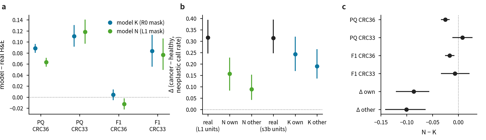

# 重訓 2 第 3 階段：新模型 N 沒有贏過舊模型 K → 判讀表第 2 列，sim2real 留用 K（2026-11-22）

依 PREREG §5（讀數、判讀表）與 §9（操作定義，2026-11-21 23:40 在任何 N 的影像之前寫入）。Hyak 路徑都在 `/gscratch/cheme/chiu/hfv_retrain2_20261121/stage3/` 之下。

**名詞：**
- **模型 K**：重訓 1 的 Concat（`tr_concat/step_0006520`），訓練用 R0 細胞核遮罩和舊的血管／氧／葡萄糖通道。
- **模型 N**：重訓 2 的 Concat（Tillicum 作業 509534，第 20 epoch），只換兩樣：細胞核遮罩改成和 H&E 對齊的 L1，ch7–9 改用方法 C（模擬端也能算出的血管／氧／葡萄糖場）。其餘設定和 K 相同。
- **訓練樣式**：模型訓練時看到的那種輸入畫法。N 的是 L1 遮罩 + 方法 C；K 的是 R0 遮罩 + 舊環境通道。每個模型都用自己的訓練樣式輸入來評估。
- **忠實度**（每張圖塊）= 模型的值 − 參考線。值是「生成圖的 CellViT 細胞核對輸入遮罩」的吻合度；參考線是「同一張圖塊的真實 H&E 對同一個遮罩」的吻合度。忠實度 > 0 表示生成圖比真實 H&E 更貼這份遮罩。
  - **次要 PQ**：全景分割品質（panoptic quality），參考 = 模型自己的訓練樣式遮罩。
  - **F1**：生成圖 CellViT 細胞核對 Lin 2023 細胞中心點的一對一配對 F1。
- **類型區分度 Δ** = 癌→腫瘤 − 健康→腫瘤：CyCIF 判為癌的細胞核被 CellViT 判為「腫瘤（Neoplastic）」的比例，減去健康細胞核被判為腫瘤的比例。0 代表 CellViT 的「腫瘤」判斷和真實細胞類型無關。
- **風格**：own = 該圖塊自己的真實 UNI 向量（P）；other = 同視窗另一張圖塊的真實 UNI（D，應用 7 的排列）。UNI 是病理基礎模型的影像特徵向量，這裡當生成的風格條件。

**圖說：**
- **a**：忠實度（模型 − 真實 H&E 參考線）。左兩組是次要 PQ，右兩組是 F1；CRC36 = crc36ho 300 張，CRC33 = crc33sec 的 Fig 2 100 張。藍 = K，綠 = N。誤差線是 95 % 圖塊 bootstrap 區間（10,000 次）。
- **b**：讀數 3 的 Δ。real = 真實 H&E，分別在 N 的 L1 真值單位和 K 的 s3b 真值單位上配對。誤差線是 12 個視窗的 95 % bootstrap 區間。
- **c**：PREREG §9.5 的六個判讀區間，都是 N − K 的配對差。

## 1. 判讀（PREREG §9.5，`r2score.py decide`，`data/stage3/decision.json`）

| 判讀項 | N − K [95 %] | 條件 |
|---|---|---|
| 忠實度 次要 PQ，crc36ho | −0.025 [−0.034, −0.017] | 整個 < 0 |
| 忠實度 F1，crc36ho | −0.017 [−0.026, −0.008] | 整個 < 0 |
| 忠實度 次要 PQ，crc33sec | +0.008 [−0.012, +0.027] | 含 0 |
| 忠實度 F1，crc33sec | −0.007 [−0.033, +0.022] | 含 0 |
| Δ，own 風格（NP − KP） | −0.086 [−0.121, −0.056] | **整個 < 0** |
| Δ，other 風格（ND − KD） | −0.101 [−0.142, −0.063] | **整個 < 0** |

- 套用順序先看第 2 列：兩種風格的 Δ 區間上界都 < 0 → **第 2 列：留用 K，回報原因**。
- 第 1 列本來也不成立：忠實度四個區間沒有全部 > 0（crc36ho 兩個整個 < 0，crc33sec 兩個含 0）。

## 2. 回報原因：N 在 sim2real 讀數上比 K 差在哪裡

**讀數 3（CRC16 的 12 個視窗，`data/stage3/r2_app8.json`）：**

| 臂 | Δ | 癌→腫瘤 | 健康→腫瘤 | 圖塊內 Δ（MH） | 核面積中位數（px²） | 偵測判為腫瘤的比例 | 每張偵測數 |
|---|---|---|---|---|---|---|---|
| 真實 H&E（L1 單位） | 0.316 | 0.566 | 0.250 | 0.259 | 397 | 0.420 | 38.7 |
| NP（N，own） | 0.157 | 0.349 | 0.192 | 0.115 | 384.5 | 0.270 | 45.5 |
| ND（N，other） | 0.090 | 0.320 | 0.230 | 0.112 | 387.5 | 0.261 | 45.4 |
| 真實 H&E（s3b 單位） | 0.314 | 0.565 | 0.251 | 0.257 | 397 | 0.420 | 38.7 |
| KP（K，own） | 0.243 | 0.436 | 0.193 | 0.179 | 391.5 | 0.325 | 45.0 |
| KD（K，other） | 0.190 | 0.429 | 0.239 | 0.176 | 394.5 | 0.332 | 44.9 |

N − K 配對差（own／other）：
- 癌→腫瘤：−0.088 [−0.115, −0.060]／−0.110 [−0.133, −0.081]。
- 圖塊內 Δ：−0.065 [−0.097, −0.038]／−0.063 [−0.103, −0.031]。
- 核面積中位數：−7.0 [−15.0, −0.5]／−7.0 [−15.5, +0.5] px²。
- 每張偵測數：+0.51 [−0.13, +1.10]／+0.49 [−0.10, +1.02]（含 0）。

所以：
- N 畫出的癌細胞核，被 CellViT 判成腫瘤的比例比 K 低（0.35 對 0.44），健康細胞核的比例幾乎不變。類型區分度因此掉了將近一半（own 0.157 對 0.243）。
- 偵測到的細胞核數量差不多，所以不是「少畫了細胞核」，而是畫出來的癌細胞核比較不像腫瘤。
- 真實 H&E 在兩種真值單位上的 Δ 幾乎相同（差 +0.001 [−0.007, +0.010]），所以真值單位換成 L1 不是 Δ 下降的原因。
- 這個比較依 PREREG §5 讓每個模型用自己的訓練樣式輸入：N 吃 L1 遮罩 + 方法 C，K 吃 s3b（R0 畫法）+ 舊環境通道。因此 N − K 同時包含「模型不同」和「輸入畫法不同」兩件事，這份結果分不開。

**讀數 1（`data/stage3/stats_r1.json`）：**
- N 的生成圖其實更貼自己的遮罩：次要 PQ 原始值 N 0.249 對 K 0.211（crc36ho）、0.436 對 0.282（crc33sec）。
- 但真實 H&E 也更貼 L1 遮罩：參考線 0.185 對 R0 的 0.122（crc36ho）、0.317 對 0.172（crc33sec）。這正是 L1 遮罩要做到的事（和 H&E 對齊）。
- 扣掉參考線後，N 在 crc36ho 比 K 低，在 crc33sec 分不出高低。
- 主要 PQ（參考 = 真實 H&E 的 CellViT 實例，描述）：N − K = +0.062 [+0.053, +0.071]（crc36ho）、+0.115 [+0.095, +0.136]（crc33sec）。N 的生成圖細胞核和真實 H&E 的細胞核更接近。

**讀數 2（外觀，描述）：**

| | crc36ho N／K | N − K [95 %] | crc33sec N／K | N − K [95 %] |
|---|---|---|---|---|
| LPIPS（越低越像） | 0.328／0.327 | +0.001 [−0.002, +0.003] | 0.394／0.362 | +0.032 [+0.022, +0.044] |
| style_hed | 0.0364／0.0360 | +0.0005 [−0.0003, +0.0013] | 0.0404／0.0371 | +0.0033 [+0.0010, +0.0058] |
| FUD（越低越像，無區間） | 162.4／154.4 | | 186.1／171.6 | |

N 的整體外觀不比 K 好；在 crc33sec 稍差。

## 3. 可以說／不能說

**可以說：**
- 依預先寫定的判讀表，第 3 階段落在第 2 列：sim2real 留用 K。
- 在 CRC16 的 12 個視窗上，N（用自己的訓練樣式輸入）讓 CellViT 把癌細胞核判為腫瘤的比例比 K 低，類型區分度兩種風格都下降，區間不含 0。
- N 的生成圖細胞核對真實 H&E 細胞核的吻合（主要 PQ）比 K 高；對自己遮罩的原始吻合也比 K 高；只是扣掉真實 H&E 參考線後沒有贏。

**不能說：**
- 不能說 L1 遮罩或方法 C 本身讓 sim2real 變差：N − K 同時換了模型和輸入畫法，而且 L1 和方法 C 是一起換的，這裡沒有拆開。
- 不能說 N 整體比 K 差：主要 PQ 是 N 較好；外觀在 crc36ho 分不出高低。
- 不能把這些數字推到模擬輸入上：讀數 3 用的是真實 CRC16 的通道（ch6 在 192 張全為 0）。模擬輸入上 N 會理會 ch6（sim-exp-validation `results_ch6_ablation.md`），是另一件事。

## 4. 執行紀錄

| 步驟 | 地點 | 作業／識別 | 實測時間 | 結果 |
|---|---|---|---|---|
| 訓練 N | Tillicum H200 | 509534 | 1:45:06 | rc 0；`controlnet_epoch_20_step_6520.pth` |
| 精簡推論包 | Hyak | 43459474 | | `infer_tr_concat2_e20.tar` md5 `73982d43…5089`；controlnet sha256 `cd500247…7f1d` |
| Fig 2 評估包、ND 輸入（第 1 次） | Hyak cheme | 43458568 | | ND 參考張量手工重建（沒有鏡射補邊）→ 不用（偏離 1） |
| ND 輸入（PixCell 讀法重建） | Hyak cheme | 43458688 | | `kin_r2ND.tar` sha256 `e580a050…7e12` |
| K 與真實 H&E 的 CellViT（Fig 2 兩組） | Hyak cheme | 43458717、43458718_0–3 | | 完成 |
| 乾跑（K 代替 N） | Hyak cheme | 43458703、43458704（讀數 3）、43458795（讀數 1–2） | 1:01、9:30 | K 側 == `results_app8.json`；通過 |
| 生成 ND（384 張） | Colab L4 `hfv_eval_L4_b` | `jobs_out_r2ND.tar` sha256 `296d6583…7031` | 925 s（2.41 s／張） | 閘門：192 張讀回 == 參考張量 |
| 生成 Fig 2 Concat，crc36ho 300 張 | 同上 | `jobs_out_fig2c_crc36ho.tar` sha256 `eba6bbca…d7f1` | 735 s | 完成 |
| 生成 Fig 2 Concat，crc33sec 100 張 | 同上 | `jobs_out_fig2c_crc33sec.tar` sha256 `6c1a0aa0…4a1b` | 267 s | 完成 |
| NP 輸入（自己的作業，偏離 2） | Hyak cheme | 43459954 | 3:15 | `kin_r2NP.tar` sha256 `80c2a365…236a`；閘門見偏離 2 |
| 生成 NP（384 張） | Colab L4 `hfv_eval_L4_b`（沿用環境，設定 30 s） | `jobs_out_r2NP.tar` sha256 `76fa87b0…19fd5` | 930 s（2.42 s／張） | 閘門：192 張讀回 == 參考張量 |
| N 的打包、CellViT（3 組）、讀數 1–2 | Hyak cheme | 43460068、43460069_0–2、43460070 | 0:40、1:28–3:11、13:50 | `score/stats_r1.json`、`fud.json` |
| NP 打包、CellViT、讀數 3 | Hyak cheme | 43460173、43460174、43460175 | 0:21、3:28、2:00 | `r2_app8.json` sha256 `95672145…8a38` |
| 判讀 | Hyak 登入節點 | `r2score.py decide` | | 第 2 列 |

- Colab session 全部以「Disconnect and delete runtime」關閉；Manage sessions 顯示「No active sessions」。
- 程式版本：hfv 3a8f0e0、4dafc20、7b62e2c（NP 臂）與本次提交（圖、結果）；PixCell cb62fa7（未修改）。
- 結果檔：`data/stage3/`（`decision.json`、`stats_r1.json`、`fud.json`、`r2_app8.json`）；圖：`scripts/r2fig.py` → `figures/fig_stage3.png`。

**執行偏離：**
1. ND 的參考張量第一次手工重建，沒有 PixCell `load_exp_channels` 對氧／葡萄糖的鏡射補邊；改用 PixCell 讀法重建（43458688），舊的不用。
2. **NP 沒有和應用 10 共用生成。** PREREG §9.3 寫的是「NP = 應用 10 的 KP 臂，同一次生成」。但 ch6 消融依它的預登記規則停在應用 10 生成之前（sim-exp-validation `results_ch6_ablation.md`），所以 NP 改成本實驗自己的作業。
   - 列、風格向量、設定與應用 10 KP 完全相同：384 列；192 個 P 向量和應用 10 `kin/uni.npz` 逐位元組相同；參考張量和 ND 的逐位元組相同（同一份 L1 + 方法 C 輸入）；20 步、導引 2.5、conditioning scale 1.0、種子 42／43。
   - NP 的輸入是真實 CRC16 通道，ch6 在 192 張全為 0，所以 ch6 的結果不會影響 NP。
   - 應用 10 之後若照原計畫生成，KP 臂可以直接用這次的 NP 影像，不必重算。
3. session 排法和 §9.4 不同：A = ch6 的一半；B = ch6 另一半 → ND → Fig 2 → NP；應用 10 沒有跑。N 的檢查點與環境和應用 10 的推論包是同一個檔案。
4. 筆記本 a 有一次誤跑了舊的 ch6a 開機指令（貼上沒有取代儲存格內容），執行約 11 分鐘後刪除該執行環境；它沒有上傳任何輸出（S3 上 `jobs_out_ch6a.tar` 仍是 01:13 的版本）。
5. `r2fig.py` 找 `figstyle` 的路徑層數寫錯（`parents[4]` → `parents[5]`），修正後才畫圖；不影響任何數字。
