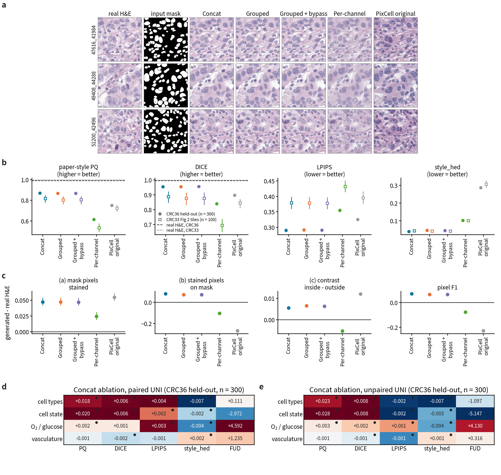
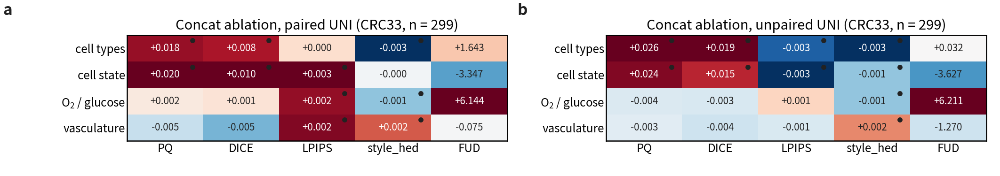

# 重訓 3 結果：用官方 CellViT 遮罩重訓的四個生成器，Fig 2 排名與 Concat 消融（2026-11-23）

照 `PREREG.md` 執行，規則在看到任何結果之前就已 push（commit fb60359）。執行流水帳和偏離紀錄的細節在 `RUNLOG_eval.md`。

## 1. 一句話

在 CRC36 保留區（300 張，沒參加訓練），照預先登記的排名規則排出的順序是：

- **第一位：Concat 和 Grouped + bypass。** 兩者是「取捨」：Concat 的 style_hed 較好，Grouped + bypass 的 DICE 較好。
- **第二位：Grouped。**
- **第三位：Per-channel 和 PixCell 原版。** 兩者也是取捨。

前三個模型之間的差距非常小（論文式 PQ 差 ≤ 0.003，DICE 差 ≤ 0.001）。它們和 PixCell 原版的差距大得多：論文式 PQ 約高 +0.12，style_hed 約好 0.24。

CRC33 的 100 張 Fig 2 tile 是訓練 tile，只報告，不進排名。在這組上，前三個模型分不出，但都排在 Per-channel 和 PixCell 原版前面，和 CRC36 的順序沒有矛盾。

Concat 消融的結論（CRC36）：
- 加入**細胞類型**或**細胞狀態**通道，論文式 PQ 和 DICE 都變好。
- 加入**氧／葡萄糖**通道，PQ 只略為變好。
- 加入**血管**通道，PQ 分不出差別，DICE 略為變差。

## 2. 讀法

- **論文式 PQ、DICE**
  - 標準答案是輸入遮罩，也就是同一張真實 H&E 的官方 CellViT 結果（細胞核之間留 1 px 縫）。預測是生成圖的官方 CellViT 結果。
  - 問的是：生成圖上的細胞核，是否落在真實組織有細胞核的位置，形狀是否相近。越高越好。
  - 參考線是真實 H&E 自己對同一份遮罩的值：CRC36 PQ 0.990 [0.990, 0.991]、DICE 0.996；CRC33 PQ 0.998、DICE 0.999。只因為 1 px 縫而略低於 1。
- **外觀**
  - LPIPS：生成圖和同一張真實 H&E 的感知距離，越小越像。
  - style_hed：H、E 兩個染色通道的平均和標準差差多少，越小越像。
  - FUD：整批生成圖和整批真實圖在 UNI-2h 特徵空間的距離，越小越像。一批只有一個數，沒有區間，只描述。
- **hematoxylin 讀數**
  - 不靠分割器，直接看蘇木素染色，門檻 t = 0.0224。
  - (a) 遮罩像素裡深染（hematoxylin ≥ t）的比例。
  - (b) 深染像素裡被遮罩蓋到的比例。
  - (c) 遮罩內平均光密度 − 遮罩外平均光密度。
  - 每項都報「生成 − 真實 H&E」的逐 tile 配對差。
- **兩種 ΔLPIPS**
  - 文字定義 = LPIPS(PixCell 原版, 真實) − LPIPS(變體, 真實)。正值表示變體比原版更像真實 H&E。
  - 程式定義 = 完整條件生成的圖，和「某一組 TME 通道歸零」後生成的圖之間的 LPIPS，四組取平均。衡量模型有多依賴這些通道。
- **區間**
  - 都是 95 % 配對 bootstrap 區間：對 tile 重抽 10,000 次，seed 42；同一評估集的所有模型用同一組重抽。
  - 區間不含 0 才說「有差別」。沒有做多重比較校正。
- **生成條件**：每個評估集的五個模型都在 Colab L4 上生成，每組的五個模型用同一種 GPU（偏離 D9、D10）。

## 3. Fig 2：四個生成器和 PixCell 原版

**圖 1**（`figures/fig_r3_main.pdf`）。
- a：CRC36 保留區的 3 張範例 tile。挑法是事先定好的規則，不看生成結果：輸入遮罩的細胞核面積比例高於 300 張的中位數 0.242，從這些 tile 中用 seed 42 抽 3 張（`data/examples_crc36ho.json`）。
- b：每個模型的平均值與 95 % 區間。實心圓 = CRC36，空心方塊 = CRC33；虛線／點線 = 真實 H&E 的參考線。
- c：CRC36 的 hematoxylin 讀數，生成 − 真實 H&E。
- d、e：CRC36 的 Concat 消融。

### 3.1 數字（`data/stats_fig2.json`）

| 模型 | 論文式 PQ 36 | DICE 36 | LPIPS 36 | style_hed 36 | FUD 36 | 論文式 PQ 33 | DICE 33 | LPIPS 33 | FUD 33 |
|---|---|---|---|---|---|---|---|---|---|
| Concat | 0.869 [0.865, 0.873] | 0.955 [0.953, 0.956] | 0.290 [0.285, 0.296] | 0.038 [0.035, 0.040] | 164.0 | 0.816 [0.777, 0.849] | 0.887 | 0.379 | 188.4 |
| Grouped | 0.866 [0.861, 0.870] | 0.955 [0.953, 0.956] | 0.292 [0.286, 0.297] | 0.045 [0.043, 0.048] | 166.4 | 0.803 [0.761, 0.840] | 0.876 | 0.378 | 192.0 |
| Grouped + bypass | 0.867 [0.863, 0.871] | 0.956 [0.954, 0.957] | 0.291 [0.285, 0.297] | 0.043 [0.041, 0.046] | 165.8 | 0.804 [0.762, 0.840] | 0.877 | 0.378 | 192.6 |
| Per-channel | 0.613 [0.601, 0.624] | 0.840 [0.829, 0.848] | 0.355 [0.349, 0.361] | 0.101 [0.097, 0.106] | 205.9 | 0.533 [0.491, 0.574] | 0.694 | 0.432 | 242.0 |
| PixCell 原版 | 0.749 [0.743, 0.755] | 0.898 [0.894, 0.901] | 0.325 [0.320, 0.331] | 0.286 [0.278, 0.295] | 194.2 | 0.723 [0.690, 0.752] | 0.844 | 0.395 | 228.8 |
| 真實 H&E（參考） | 0.990 [0.990, 0.991] | 0.996 | — | — | — | 0.998 | 0.999 | — | — |

- 36 = CRC36 保留區（300 張）；33 = CRC33 次要組（100 張）。CRC33 的 style_hed 和其餘欄的區間在 `data/stats_fig2.json`。
- **PixCell 原版的論文式 PQ 0.749／0.723，和論文的 0.70 接近。** 這次兩邊用同一種 CellViT 後處理，輸入遮罩也就是標準答案，所以這個數可以和論文比。重訓 1 的 PQ 只有 0.14–0.22，是因為當時輸入遮罩（Lin 分割）不是標準答案，這次已不是這種情況。

### 3.2 事先宣告的比較（PREREG §5.3）

**每個變體 − PixCell 原版（CRC36）：**
- Concat、Grouped、Grouped + bypass 四個讀數都比原版好：
  - 論文式 PQ +0.116 到 +0.120（Concat +0.120 [+0.114, +0.125]）；
  - DICE +0.057 到 +0.058；
  - LPIPS −0.034 到 −0.035（Concat −0.035 [−0.037, −0.032]）；
  - style_hed −0.24 到 −0.25。
- Per-channel 只有 style_hed 比原版好（−0.185 [−0.194, −0.177]）；論文式 PQ −0.137 [−0.146, −0.127]、DICE −0.058、LPIPS +0.030 都比原版差。
- CRC33 的方向相同。差別在於 Grouped 和 Grouped + bypass 的 DICE 和原版分不出（Grouped +0.032 [−0.011, +0.067]）。

**Concat − Grouped（CRC36）：**
- 論文式 PQ +0.003 [+0.001, +0.006]、LPIPS −0.0011 [−0.0021, −0.0002]、style_hed −0.0076 [−0.0086, −0.0066]：三項 Concat 較好。
- DICE +0.000 [−0.001, +0.001]，分不出。
- CRC33 四項都分不出。

**Concat − Grouped + bypass（CRC36）：**
- style_hed −0.0057 [−0.0066, −0.0048]，Concat 較好。
- DICE −0.001 [−0.001, −0.000]，Grouped + bypass 較好。
- 論文式 PQ +0.002 [−0.000, +0.004]、LPIPS 分不出。
- CRC33 四項都分不出。

### 3.3 排名（PREREG §5.4：只用 CRC36、四個讀數，不含數字門檻）

| 兩兩比較 | 結果 | A 較好的讀數 | B 較好的讀數 |
|---|---|---|---|
| Concat vs Grouped | Concat 在前 | 論文式 PQ、LPIPS、style_hed | — |
| Concat vs Grouped + bypass | 取捨 | style_hed | DICE |
| Grouped vs Grouped + bypass | Grouped + bypass 在前 | — | 四項都是 |
| Concat、Grouped、Grouped + bypass vs Per-channel | 前者在前 | 四項都是 | — |
| Concat、Grouped、Grouped + bypass vs PixCell 原版 | 前者在前 | 四項都是 | — |
| Per-channel vs PixCell 原版 | 取捨 | style_hed | 論文式 PQ、DICE、LPIPS |

- **順序：** {Concat、Grouped + bypass}（取捨）→ Grouped → {Per-channel、PixCell 原版}（取捨）。
- Grouped + bypass 勝過 Grouped 的四項差距都很小：論文式 PQ 0.001、DICE 0.001、LPIPS 0.0007、style_hed 0.0019。它排在前面，是因為兩者的生成圖非常相近，配對區間因此很窄。
- **CRC33（只報告）：** 前三個模型兩兩「並列」（四項都分不出），三者都排在 Per-channel 和 PixCell 原版前面；Per-channel 和 PixCell 原版是取捨。沒有任何一對的方向和 CRC36 相反。

### 3.4 只報告、不進規則的讀數

**hematoxylin 讀數（生成 − 真實 H&E，CRC36）：**

| 模型 | (a) | (b) | (c) | F1 |
|---|---|---|---|---|
| Concat | +0.047 [+0.042, +0.054] | +0.079 [+0.073, +0.086] | +0.0055 | +0.069 |
| Grouped | +0.047 | +0.071 | +0.0065 | +0.063 |
| Grouped + bypass | +0.047 | +0.072 | +0.0063 | +0.064 |
| Per-channel | +0.024 | −0.105 [−0.111, −0.099] | −0.0054 | −0.079 |
| PixCell 原版 | +0.055 | −0.269 [−0.278, −0.260] | +0.0120 | −0.228 |
| 真實 H&E（絕對值） | 0.938 | 0.619 | 0.0268 | 0.737 |

- 三個 TME 模型的圖比真實 H&E 自己更像「深染就在遮罩上」：(b) 高約 0.07–0.08。這和 sim-exp-validation 遮罩忠實度實驗的結論一致：生成圖比真實 H&E 更照遮罩畫。
- PixCell 原版的遮罩像素也深染（(a) +0.055），但遮罩外還有很多深染（(b) −0.27），也就是會在遮罩以外多畫深色的東西。
- **CRC33**：
  - 三個 TME 模型和 PixCell 原版的方向與 CRC36 相同。三個 TME 模型 (a) +0.07、(b) +0.10 到 +0.11；PixCell 原版 (a) +0.10、(b) −0.15 [−0.18, −0.13]。
  - Per-channel 不同。(a) 是 −0.087 [−0.110, −0.065]：遮罩像素反而比真實 H&E 少深染；(b) −0.008 [−0.025, +0.007]，分不出。
  - 真實 H&E 的絕對值：(a) 0.860、(b) 0.536、(c) 0.0254、F1 0.644。
- **空遮罩**：有些 tile 的輸入遮罩是空的（官方 CellViT 在真實 H&E 上沒找到細胞核），這些 tile 的 (a)、(c)、F1 沒有定義。所以 CRC36 n = 298，CRC33 n = 93；(b) 用全部 tile。

**文字定義的 ΔLPIPS（CRC36）：**
- Concat +0.035 [+0.032, +0.037]、Grouped +0.034、Grouped + bypass +0.034；Per-channel −0.030 [−0.033, −0.027]。
- CRC33：前三者 +0.017 到 +0.018，Per-channel −0.037。

**程式定義的 ΔLPIPS（CRC36，四組平均）：**
- Grouped 0.048 [0.047, 0.049]、Grouped + bypass 0.012、Per-channel 0.009、Concat 0.007 [0.007, 0.008]。
- CRC33：Grouped 0.045、Grouped + bypass 0.012、Concat 0.011、Per-channel 0.008。Grouped 仍然最大，只有 Concat 和 Per-channel 互換位置。
- 也就是說，Grouped 拿掉一組通道時，圖改變得最多。

**FUD：** 見 3.1 的表。三個 TME 模型 164–166（CRC36）／188–193（CRC33），PixCell 原版 194／229，Per-channel 206／242。

## 4. Concat 消融：加入一組通道的平均效果（Fig 2e/g）

**圖 2**（`figures/fig_r3_abl33.pdf`）。CRC33 的 299 張；CRC36 在圖 1 d、e。

- **怎麼算：** 照 PixCell `summarize_added_group_effect_stats`。對其他三組的每一種組合，比較「加入這組」和「不加」的差，再平均。正值 = 加入這組讓指標變好（LPIPS、style_hed、FUD 已換號，所以也是正值 = 變好）。
- **圖上的點：** 黑點 = 區間不含 0。FUD 一批只有一個數，沒有區間，也不畫點。
- 數字在 `data/stats_abl_crc36ho.json`、`data/stats_abl_crc33sec.json`。

| 加入的通道組 | PQ 36 paired | PQ 36 unpaired | DICE 36 paired | LPIPS 36 paired | style_hed 36 paired | PQ 33 paired | PQ 33 unpaired |
|---|---|---|---|---|---|---|---|
| 細胞類型 | +0.018 [+0.016, +0.020] | +0.023 [+0.021, +0.025] | +0.006 [+0.004, +0.007] | +0.004 | −0.007 | +0.018 [+0.012, +0.024] | +0.026 [+0.021, +0.032] |
| 細胞狀態 | +0.020 [+0.019, +0.022] | +0.028 [+0.026, +0.030] | +0.006 [+0.005, +0.007] | +0.002 | −0.002 | +0.020 [+0.014, +0.027] | +0.024 [+0.019, +0.030] |
| 氧／葡萄糖 | +0.002 [+0.000, +0.004] | +0.003 [+0.001, +0.004] | +0.001（分不出） | +0.003 | −0.004 | +0.002（分不出） | −0.004（分不出） |
| 血管 | −0.001 [−0.003, +0.000]（分不出） | −0.001（分不出） | −0.002 [−0.003, −0.001] | −0.001（分不出） | +0.002 | −0.005 [−0.010, +0.001]（分不出） | −0.003（分不出） |

- **照遮罩畫（論文式 PQ、DICE）**
  - 細胞類型、細胞狀態兩組在兩個評估集、兩種風格來源下都讓 PQ 變好，約 +0.02。
  - 氧／葡萄糖只在 CRC36 讓 PQ 略為變好。
  - 血管在 PQ 上都分不出；在 CRC36 的 DICE 上略為變差（paired −0.002，unpaired −0.001）。
- **外觀**
  - LPIPS（CRC36）：paired 時，細胞類型、細胞狀態、氧／葡萄糖讓 LPIPS 變好；unpaired 時，細胞類型、細胞狀態、血管反而讓 LPIPS 略差。CRC33 paired 時，細胞狀態、氧／葡萄糖、血管讓 LPIPS 變好；unpaired 時，細胞類型、細胞狀態讓它略差。
  - style_hed：細胞類型、細胞狀態、氧／葡萄糖讓它變差，血管讓它變好（+0.0015）。所有 LPIPS／style_hed 的效果量 |效果| ≤ 0.007。
  - FUD（無區間）：氧／葡萄糖最大（CRC36 +4.6／+4.1，CRC33 +6.1／+6.2），細胞狀態是負值（−3.0／−5.1）。
- **和重訓 1 的消融不能直接比。** 重訓 1 的 PQ 標準答案是真實 H&E 的 CellViT，但輸入是 Lin 遮罩，兩者不同；這次輸入遮罩就是標準答案。重訓 1 裡血管組讓 PQ 變好（+0.038），這次沒有，可能就是這個差別造成的，但這個實驗沒有檢驗原因。

## 5. 偏離紀錄（細節在 `RUNLOG_eval.md` §3）

- **D1** 1 px 縫從少數細胞核切下小碎片，改成每個核只保留最大的一塊。訓練集清掉 20 個核、42 px；保留區清掉 3 個核、6 px。
- **D2** CRC33 評估包重建成 1,028 張 tile，不是 824 張。舊包裡另有 204 張「只當風格來源」的 tile 也帶著通道檔（作業 43467455、43467456）。
- **D3** 遮罩 latent 改在任意 ckpt GPU 上跑（RTX 6000，43467293），不是 A100。裝置比對和重訓 2 相同（最大差 0.00195）。
- **D4** presign 呼叫把連結寫進資料夾，所以前三個訓練作業沒有連結。512595、512596 在 3 s 時被程式自己的檢查擋下，花費可忽略；512597 在排隊時取消。只修正連結後重送為 512599–512601。
- **D5** CRC36 消融生成：Hyak A100（43469094）排隊 15 分鐘未開始，移到 Colab L4_b。
- **D6** CRC33 消融生成：Hyak A100（43469095）排隊 2 小時 20 分未開始，移到 Colab L4_b，沿用同一個 runtime。共 6799 s。
- **D7** Fig 2 生成改送 Hyak ckpt A40，不是 A100；這兩個作業後來也沒開始（D9、D10）。
- **D8** 評分用 40 核，不是 32 核。第一次送 64 核被 Slurm 拒收，不是作業失敗。
- **D9** CRC36 Fig 2 生成：Hyak A40（43470820）排隊 1 小時 50 分未開始，移到 Colab L4_b。共 15975 s。
- **D10** CRC33 Fig 2 生成：Hyak A40（43470821）排隊 2 小時 09 分未開始，移到 Colab L4_a（cpm_tracks 交還之後）。第一次連線卡住約 10 分鐘，重新載入頁面後成功。共 5678 s。
- **D11** CRC36 消融評分的節點 n3026，對 /gscratch 的小檔寫入很慢：單檔 1.84 s，登入節點約 0.006 s。已記進慢節點登錄，結果改從節點 /tmp 串流回來；作業最後也自己完成。之後的評分作業都避開慢節點。
- **圖的修正（不影響數字）：** `scripts/fig_r3.py` 拿掉了熱圖 FUD 欄的「區間不含 0」黑點。FUD 沒有區間，那些點是用零寬度區間算出來的。另外替 b 加上圖例，並移開和縱軸標題重疊的面板字母。數字沒有改變。

## 6. 花費與資源

- **Tillicum：** `hyakusage` 實查累計 $34.91（上限 $40）。重訓 3 四個模型約 $7.71（預估 $7.68）。
- **GPU 生成：** 全部在 Colab L4，同時最多 2 個 runtime；用完都已「Disconnect and delete runtime」。
- **評分：** Hyak cheme CPU，每個作業 40 核。
