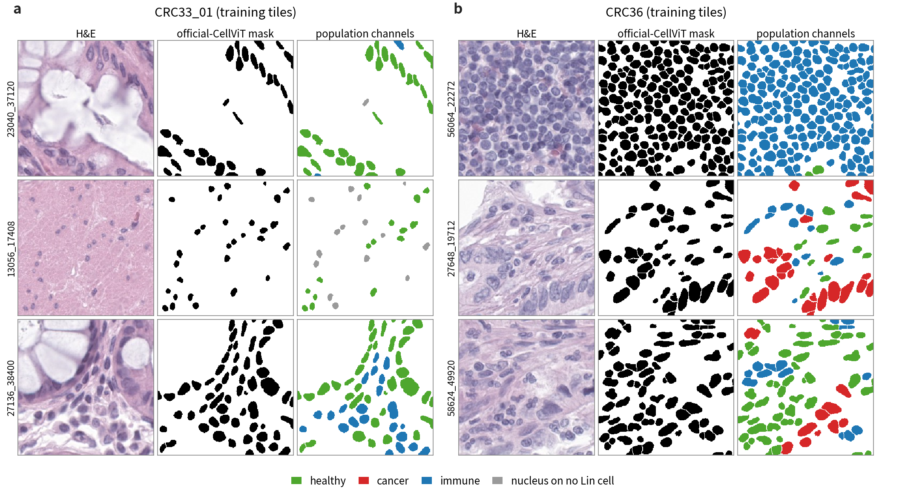

# 重訓 3 階段報告：官方 CellViT 遮罩的訓練輸入建好了（2026-11-22）

> 預先登記：`PREREG.md`（commit fb60359）。這份只報輸入建置，還沒有任何訓練或生成的數字。
> 名詞：**官方 CellViT 遮罩** = 每張 tile 的真實 H&E 跑 CellViT-256 官方後處理（HV 分水嶺把相黏的細胞核切開）得到的細胞核，畫成二值遮罩；**官方 CellViT 遮罩生成器** = 用這種遮罩重訓的 Concat、Grouped、Grouped + bypass、Per-channel。

## 1. 一句話

- 三萬多張真實 H&E（CRC33_01 9,418、CRC36 訓練 16,651、CRC36 保留區 1,092）都跑完官方 CellViT。
- 細胞核畫成遮罩，CELESTA + Lin Fig. 3d 的類型和狀態轉貼上去，打包上傳。
- 閘門 1–4 都通過（第 3 條是修正後才通過，見偏離 D1）。
- Tillicum 的預估花費不變：$7.68，剩 $12.80。

## 2. 做法（照預先登記 §3）

1. **細胞核**：每張 tile 的真實 H&E 跑官方 CellViT。
   - 設定和 `cellvit_official_20261122` 相同：runner 467a54f、CellViT-256、batch 32、Hyak cheme CPU、TF32 關閉。
   - 35 個陣列任務（作業 43466587），每個 800 張，8 核心，每個任務 960–1,324 秒（約每張 1.2–1.7 秒）。
2. **畫遮罩**：
   - 先用 PixCell `_cellvit_json_to_instance_mask` 把 JSON 的輪廓填成實例圖。之後給生成圖打分也是用這個函式。
   - 再用 `separate_instances` 在相黏的細胞核之間留 1 px 縫，存成 0／255 的 PNG。
3. **類型和狀態**：每個細胞核找重疊像素最多的 Lin 整細胞遮罩（平手取 CellID 小的），用那個 Lin 細胞的 CELESTA + Lin Fig. 3d 標籤。
   - 和任何 Lin 細胞都不重疊的細胞核只畫進 `cell_masks`。
   - CellViT 自己的類型輸出完全沒讀。
4. **血管、氧、葡萄糖**：重訓 2 的方法 C 檔案，逐位元組沿用。
5. **遮罩 latent**：SD3.5 VAE。用 PixCell `stage1_extract_features.py`，沒有改。
   - 作業 43467293，Hyak ckpt Quadro RTX 6000，9 分 14 秒。
   - 裝置比對：64 張舊遮罩重算 latent，和存檔比，最大絕對差 0.00195。這和重訓 2 在 A100 上的比對結果完全相同。

## 3. 閘門

| # | 內容 | 結果 |
|---|---|---|
| 1 | JSON 數 = tile 數 | 9,418／16,651／1,092，全部相符 |
| 2 | 重現：CRC36 保留區 300 張、CRC33 Fig 2 100 張的官方 CellViT，和 `cellvit_official_20261122` 存的結果比 | 300／300、100／100 實例圖完全相同（PQ 全部 = 1，個數差 0）；預先登記的門檻是 298／300、100／100 |
| 3 | 二值遮罩的 8 連通區塊數 = 實例數；類型、狀態通道互斥，聯集 = 有配到 Lin 的細胞核；值只有 0／255 | 第一次不過（D1），修正後全部通過 |
| 4 | 每個訓練 id 有 10 個通道和遮罩 latent；打包後重讀 sha256 相同 | 通過（newch33_v3 94,181 個成員、masklat33_v3 9,418、c36train_v3 216,464） |
| 5 | Tillicum 準備（md5、張數、索引 26,069 筆） | 進行中（`setup3.sh`） |

## 4. 配對數字（預先登記 §3.2，只描述，不是門檻）

「沒配到的細胞核」：官方 CellViT 找到的細胞核，任何像素都不在 Lin 的整細胞遮罩上。這些核在 `cell_masks` 裡有，但類型和狀態通道裡沒有。

「沒被選中的 Lin 細胞」：質心落在 tile 內的 Lin 細胞中，沒有任何細胞核把它選為「重疊最多」的那一個。這些細胞的類型不會出現在通道裡。

| | CRC33_01 訓練 | CRC36 訓練 | CRC36 保留區 | CRC33 評估包 |
|---|---|---|---|---|
| tile 數 | 9,418 | 16,651 | 1,092 | 1,028 |
| 官方 CellViT 細胞核 | 294,966 | 829,812 | 59,463 | 16,620 |
| 沒配到的細胞核（個數） | 2.95 % | 0.48 % | 0.27 % | 6.09 % |
| 沒配到的細胞核（像素） | 1.66 % | 0.31 % | 0.10 % | 3.76 % |
| Lin 細胞（質心在 tile 內） | 398,137 | 1,180,356 | 88,278 | — |
| 每個 Lin 細胞被幾個細胞核選中：0 | 33.0 % | 36.7 % | 39.2 % | — |
| 　1 | 65.1 % | 60.4 % | 57.9 % | — |
| 　≥ 2 | 1.9 % | 2.9 % | 2.9 % | — |
| 沒被選中的 Lin 細胞：healthy／cancer／immune | 34.0／40.4／27.6 % | 38.5／41.0／32.7 % | 37.4／42.3／37.7 % | — |
| 留縫切掉的小碎片（D1） | 3 個核、3 px | 14 個核、33 px | 3 個核、6 px | 0 |

怎麼讀：

- **官方 CellViT 找到的細胞核比 Lin 的細胞少。** 細胞核數 ÷ Lin 細胞數：CRC33_01 0.74、CRC36 0.70。所以約三分之一的 Lin 細胞沒有對應的細胞核，它們的類型也就不會進通道。
- 三種類型的「沒被選中」比例相近（27–42 %）。所以類型組成大致保留：
  - CRC33_01 的 Lin 細胞是 healthy／cancer／immune = 77／3／20 %，配到的細胞核是 76／3／21 %；
  - CRC36 是 27／30／44 % 對 25／28／46 %。
- 狀態：配到的細胞核中，增殖的比例是 CRC33_01 4.1 %、CRC36 18.4 %。死細胞是 0.17 % 和 0.04 %，幾乎是空的，和重訓 2 相同（記憶 `dead-channel-empty`）。
- CRC33 評估包「沒配到」的比例（6.1 %）比 CRC33_01 全部訓練 tile（3.0 %）高。這裡只記下這個差，沒有查原因。

## 5. 接觸表

- 每張切片 3 張訓練 tile。抽法：細胞核數高於該切片中位數的 tile（CRC33_01 中位數 25，4,569 張候選；CRC36 中位數 50，8,258 張候選）中，用 `default_rng(42)` 抽。
- 每張 tile 三欄：真實 H&E | 官方 CellViT 遮罩 | 類型通道。類型通道的顏色：綠 healthy、紅 cancer、藍 immune、灰 = 沒配到 Lin 細胞。
- 遮罩跟著 H&E 上的深染細胞核走，相黏的核之間有 1 px 縫。CRC33_01 第二張（13056_17408）的基質區灰色比較多，是 Lin 遮罩沒涵蓋的細胞核。

## 6. Tillicum 花費預估（預先登記 §4，沒有新的實測）

- 15:15 實查（`hyakusage -s 2026-10-09`）：已用 $27.20，剩 $12.80；實驗室帳號 67.20／90。
- 預估照重訓 1、2 的實測時間：Concat $1.59、Grouped $1.94、Grouped + bypass $1.94、Per-channel $2.21，合計 $7.68。
- 規則不變：先只送 Concat。跑完讀 `hyakusage`，用實測比例重算其他三個，不超過才送。

## 7. 偏離紀錄

- **D1 留縫切出的小碎片**
  - 問題：閘門 3 第一次不過（作業 43466941、43466944）。CRC33 14592_13824 有 65 個連通區塊、64 個核；CRC36 18432_19968 有 129 個區塊、128 個核。
  - 原因：用 602 張隨機 tile 檢查，填輪廓後的實例圖本身沒有碎片；碎片全是 1 px 縫造成的，縫在某個核的邊上切下 1–2 px 的孤立小塊。
  - 修正：每個核只保留最大的 8 連通塊，切下的小塊清掉並計數。共 20 個核、42 px，佔全部像素不到百萬分之一。
  - 修正後重跑（43467030、43467031）閘門全過。修正寫在 `cells_oc.py`。
- **D2 CRC33 評估包有 1,028 張帶通道的 tile，不是 824 張**
  - 重訓 1 的 `evalpack_crc33sec.tar` 裡，除了 824 張列出的 tile，還有 204 張「只當風格來源」的 tile 也帶著通道檔。
  - 為了不留下任何舊遮罩，這 1,028 張全部換成官方 CellViT 遮罩：另一個只建評估集的作業 43467455；遮罩 latent 用 43467456。
  - 這 204 張只提供 unpaired 消融的 UNI，生成時不讀它們的通道。
- **D3 遮罩 latent 的 GPU 型號**
  - 預先登記寫的是 ckpt A100，但 A100 排隊（作業 43467058 預計等 30 分鐘以上），取消後改成任意 ckpt GPU。重訓 2 最後也是這樣做的。
  - 實際用 RTX 6000（43467293）。裝置比對和重訓 2 在 A100 上的結果相同（最大差 0.00195）。

## 8. 檔案

- 程式：`scripts/`（`prep_he.py`、`cv3.slurm`、`gate2.py`、`cells_oc.py`、`cells3.slurm`、`masklat3.slurm`、`pack3.py`、`evalpack3.py`、`sheet_pick.py`、`fig_sheet.py`）；`tillicum/`（`presign3.py`、`setup3.sh`、`tr3.slurm`）。
- 數據：`data/`（`cells_*_OC*.json` 摘要、`tiles_*_OC.csv` 逐 tile 計數、`gate2.json`、`pack.json`、`devcheck.json`、`sheet/`）。
- Hyak：`/gscratch/cheme/chiu/hfv_retrain3_cellvit_20261122/`；S3：`s3://bagherilab-working/pohao/hfv_retrain3_cellvit_20261122/inputs/`。
