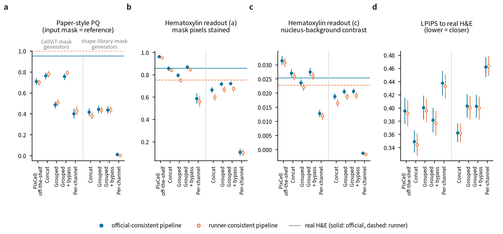

# 結果：輸入遮罩就是標準答案時的論文式 PQ，全程用 CellViT 官方後處理（2026-11-22）

事前登記：`PREREG.md`（commit faeac93，在任何新數字之前 push）。名詞、生成器名稱和兩條管線的定義都照 PREREG §1；內文只用名稱，代號只出現在檔名和 PREREG §1.1 的對照表。

## 0. 先講結論

1. **閘門沒有全部通過（PREREG §9）。** hfv 舊後處理一致管線重新生成後：
   - PixCell 原版、CellViT 遮罩生成器的 Concat、Grouped＋bypass 三個論文公布值都落在 95 % 區間內，而且幾乎逐位重現（0.7005／0.7818／0.7938，論文 0.6987／0.7817／0.7943）。
   - **Per-channel 沒有重現：** 論文 0.0106，重新生成 0.431 [0.386, 0.474]。
   - 依 PREREG §9 的規則，官方一致管線的結果「先不解讀，查原因後回報」。下面的表照實列出數字，但 §5 的排序**只是依規則算出的暫定排序，還沒有被採用**。
2. **原因已經查到一半（§2）。**
   - 評分程式沒有問題：用論文自己的 CellViT 結果檔重算，Per-channel 得到 0.0106，DICE 0.054，和論文 cache 一模一樣；另外三個生成器也一樣。
   - 差別在**圖本身**：論文那批 Per-channel 生成圖平均每張只找到 5.4 個核，我們用 S3 上同一個 checkpoint（`tillicum_95470/per_channel_95470_3`）和它自己的 `config.py` 重新生成，平均每張 15.2 個核（輸入遮罩 20.6 個）。
   - 所以論文那批 Per-channel 圖不是這個 checkpoint 加這個 config 生出來的。
   - S3 上還有另一個 Per-channel checkpoint `per_channel/full_seed_42`（TME 模組檔案大小不同），是可能的來源，但這次沒有測（要再跑一次 GPU 生成，不在事前登記裡）。
3. **其他三個生成器的數字可以信。** 官方一致管線下，論文式 PQ 是：
   - PixCell 原版 0.711 [0.676, 0.742]；
   - Concat 0.764 [0.730, 0.795]；
   - Grouped＋bypass 0.756 [0.722, 0.786]；
   - Grouped 0.485 [0.451, 0.520]。

   和 hfv 舊後處理一致管線比：Concat、Grouped＋bypass 降了 0.02–0.04，PixCell 原版反而升了 0.01。前一份實驗只換評分端，降了 0.10–0.13；兩端一致後，大部分的落差消失了。
4. **Concat 和 Grouped＋bypass 在兩條管線都分不開**（官方：差 +0.008 [−0.022, +0.038]；hfv 舊後處理：差 −0.012 [−0.037, +0.005]）。所以論文 Fig 2 裡「Grouped＋bypass 0.79 > Concat 0.78」的先後，在這 100 張圖塊上不能寫成先後，只能寫成並列。
5. **沒有任何 Grouped 架構得到 sim2real 標記**（PREREG §8.4）：官方一致管線下，沒有一個 Grouped 架構在 PQ、(a)、(c) 三個讀數上都穩定高於同組的 Concat。

## 1. 圖

`figures/fig_paperpq.png`／`.pdf`（`scripts/pp_fig.py data figures/fig_paperpq.png`）。

- 每個點 = 100 張圖塊的平均，線段 = 圖塊 bootstrap 95 % 區間。
- 實心藍 = 官方一致管線；空心橘 = hfv 舊後處理一致管線。
- 水平線 = 真實 H&E 對它自己的遮罩（實線：官方；虛線：hfv 舊後處理）。
- 灰色直線左邊是主要組（PixCell 原版＋CellViT 遮罩生成器），右邊是次要組（形狀庫遮罩生成器）。
- 圖上的 CellViT 遮罩生成器 Per-channel 是**這次重新生成的圖**，不是論文那批（§2）。

## 2. 閘門與 Per-channel 的診斷

### 2.1 閘門（PREREG §9）

| 生成器 | 論文公布 | hfv 舊後處理一致管線重新生成 | 在區間內？ |
|---|---|---|---|
| PixCell 原版 | 0.6987 | 0.700 [0.669, 0.727] | 是 |
| CellViT 遮罩生成器 Concat | 0.7817 | 0.782 [0.746, 0.812] | 是 |
| CellViT 遮罩生成器 Grouped＋bypass | 0.7943 | 0.794 [0.767, 0.816] | 是 |
| CellViT 遮罩生成器 Per-channel | 0.0106 | 0.431 [0.386, 0.474] | **否** |
| CellViT 遮罩生成器 Grouped（不設閘門） | 0.5694 | 0.506 [0.474, 0.536] | （只並列） |

描述（不是門檻）：重新生成的圖和論文那批圖（S3 `si_a1_a2/tiles/<變體>`）逐像素比較（`scripts/pp_paperimg.py`，作業 43468629）：

| 生成器 | 逐像素相同 | 每張 LPIPS 平均 |
|---|---|---|
| Concat | 0／100 | 0.00005 |
| Grouped＋bypass | 0／100 | 0.00014 |
| Per-channel | 0／100 | **0.219** |
| PixCell 原版 | 0／100 | 0.294（論文那次沒設 seed，本來就不期待相同） |
| Grouped | 0／100 | 0.189（論文那批圖已被覆蓋，見 PREREG §2） |

LPIPS 是兩張圖的感知距離，0 = 看起來一樣。Concat 和 Grouped＋bypass 每張只差 10⁻⁴ 量級：這次在 L4、論文在別種 GPU，浮點運算順序不同造成的雜訊，看不出差別。Per-channel 差 0.22，和「完全不同的兩張圖」同一個量級。

### 2.2 診斷：差別在評分、還是在圖？（`scripts/pp_diag_perch.py`，作業 43469023）

論文的每張生成圖旁邊存著它當時的 CellViT 結果檔（`<圖塊>_cellvit_instances.json`，hfv 舊後處理）。用這些結果檔，和這次同樣的 PixCell 函式、同樣的論文 `cell_masks` 重算：

| 生成器 | 論文的圖＋論文的 CellViT 結果：PQ／DICE／每張核數 | 這次重新生成的圖＋這次的 CellViT：PQ／DICE／每張核數 |
|---|---|---|
| Per-channel | **0.0106／0.054／5.4** | 0.431／0.592／15.2 |
| Concat | 0.7817／0.883／20.6 | 0.7818／0.883／20.6 |
| Grouped＋bypass | 0.7943／0.893／20.7 | 0.7938／0.894／20.8 |
| PixCell 原版 | 0.6987／0.853／20.9 | 0.7005／0.854／20.7 |

- 論文的數字（0.0106、DICE 0.054）用論文自己的圖重算，**逐位重現**，所以評分程式、標準答案的讀法都和論文一樣。
- 差別完全在 Per-channel 的圖：論文那批圖在遮罩說有核的地方大多沒畫出核（每張 5.4 個核，對 20.6 個）。這次的圖雖然也偏弱（15.2 個核，hematoxylin 讀數 (c) 只有真實 H&E 的一半），但大致照遮罩畫。並排看三張圖塊也是這樣（診斷用，沒有放進報告圖）。
- 這次載入的權重本身沒問題：ControlNet 475 個張量全部載入，沒有缺漏也沒有多餘。
- **可能的原因（未驗證）：** S3 有兩個 Per-channel checkpoint：
  - build_cache.py 指到的 `tillicum_95470/per_channel_95470_3`（這次用的，TME 模組 28,105,657 bytes）；
  - `per_channel/full_seed_42`（TME 模組 28,105,017 bytes）。

  論文那批圖可能來自後者，或來自當時不同的 config。要確認，就得用後者再生成 100 張，比對它和論文那批圖的 LPIPS。

**需要決定的事（使用者）：** 論文 Fig 2 的 Per-channel 要報哪個數字？
- 0.0106 來自一批無法用現存 checkpoint 加 config 重現的圖；
- 0.431 / 0.401 是現存 checkpoint 加 config 的結果。

這只影響 Per-channel 一欄。另外三個公布值都重現了，所以「官方一致管線下其他生成器的數字」不受影響。但事前登記的規則是整個閘門通過才解讀，所以 §5 的排序等這個決定之後才算數。

## 3. 輸入：標籤轉貼（PREREG §3.2）

| 生成器組 × 輸入遮罩 | 新核總數 | 配上 | 沒配上 | 沒配上比例 | 有沒配上的圖塊數 |
|---|---|---|---|---|---|
| CellViT 遮罩生成器 × 官方 CellViT 遮罩 | 2,248 | 2,216 | 32 | 1.4 % | 21／100 |
| 形狀庫遮罩生成器 × hfv 舊後處理 CellViT 遮罩 | 2,077 | 1,711 | 366 | 17.6 % | 87／100 |
| 形狀庫遮罩生成器 × 官方 CellViT 遮罩 | 2,248 | 2,002 | 246 | 10.9 % | 79／100 |
| CellViT 遮罩生成器 × hfv 舊後處理 CellViT 遮罩 | （就是論文的輸入，不轉貼） | | | | |

- 「配上」= 新核的像素超過一半落在舊遮罩的核上；類型、狀態取重疊像素最多的通道，整顆新核畫進去。「沒配上」的核只畫進細胞核通道，沒有類型、狀態。
- 三組都沒有同票、沒有留空。
- 形狀庫遮罩生成器的沒配上比例高（11–18 %），因為它的舊核是 Lin 細胞位置加形狀庫輪廓，和 CellViT 找到的核位置本來就不完全重疊。這也是它們在兩條管線都「不在訓練分佈裡」的一部分原因。

其他輸入檢查（`data/gates.json`，作業 43466537，全部通過）：
- 100 張圖塊 = hfv `crc33sec_fig2_ids`；
- 真實 H&E 在論文 zip、評估包、F2_P_gt.zip 三處逐像素相同；
- 所有細胞通道都是 0／255；
- 官方 JSON 100 個都在；
- 兩組生成器的 UNI、血管、氧、葡萄糖檔案各自 100／100 相同；
- Per-channel 的 `config.py` 能被 PixCell 讀進來（10 個通道）。

描述：Hyak CPU 上重跑的 hfv 舊後處理 JSON 重畫成遮罩後，只有 48／100 張和論文 `cell_masks` 逐像素相同。論文的遮罩是更早一次 GPU 執行的結果；這次的閘門用的是論文 `cell_masks` 本身，所以不受影響。

## 4. 讀數表（平均 [95 % 區間]，100 張圖塊；左：官方一致管線，右：hfv 舊後處理一致管線）

各讀數的意思（PREREG §1）：
- **論文式 PQ**：生成圖上 CellViT 找到的核，和「生成器拿到的那張輸入遮罩」一對一配對，IoU ≥ 0.5 才算配上，PQ = 配上的核的平均 IoU × 偵測 F1；1 = 一模一樣。
- **DICE**：不分個別的核，只看「核像素」重疊多少。
- **hematoxylin 讀數**不經過任何分割器：
  - (a) 遮罩內深染像素的比例（遮罩說有核的地方有沒有畫出深染的核）；
  - (b) 深染像素落在遮罩內的比例（有沒有在遮罩外多畫核）；
  - (c) 遮罩內外的平均光密度差（核和背景的對比）。

### 4.1 論文式 PQ

| 生成器 | 官方一致管線 | hfv 舊後處理一致管線 |
|---|---|---|
| 真實 H&E（參考線） | 0.953 [0.937, 0.968] | 0.999 [0.999, 1.000] |
| PixCell 原版 | 0.711 [0.676, 0.742] | 0.700 [0.669, 0.727] |
| CellViT 遮罩生成器 Concat | 0.764 [0.730, 0.795] | 0.782 [0.746, 0.812] |
| CellViT 遮罩生成器 Grouped | 0.485 [0.451, 0.520] | 0.506 [0.474, 0.536] |
| CellViT 遮罩生成器 Grouped＋bypass | 0.756 [0.722, 0.786] | 0.794 [0.767, 0.816] |
| CellViT 遮罩生成器 Per-channel（重新生成） | 0.401 [0.353, 0.449] | 0.431 [0.386, 0.474] |
| 形狀庫遮罩生成器 Concat | 0.416 [0.380, 0.452] | 0.384 [0.351, 0.417] |
| 形狀庫遮罩生成器 Grouped | 0.443 [0.407, 0.480] | 0.435 [0.400, 0.470] |
| 形狀庫遮罩生成器 Grouped＋bypass | 0.438 [0.403, 0.473] | 0.440 [0.406, 0.473] |
| 形狀庫遮罩生成器 Per-channel | 0.011 [0.001, 0.032] | 0.001 [0.000, 0.002] |

- 真實 H&E 在官方管線是 0.953 而不是 1：官方後處理把相碰的核切開，但畫成二值遮罩 PNG 再讀回時，相碰的核連成一塊、變成一個核。這是論文流程本身的作法（PREREG §1）。
- 不二值化的版本（`pq_inst`，標準答案直接用官方實例圖）真實 H&E = 1.000。CellViT 遮罩生成器和 PixCell 原版的 `pq_inst` 比 `pq` 高 0.000–0.015（例如 Concat 0.778、Grouped＋bypass 0.771、PixCell 原版 0.717）；形狀庫遮罩生成器反而低 0.000–0.007。各組內的先後不變（`data/stats.json`）。

### 4.2 DICE 和 hematoxylin 讀數

| 生成器 | DICE 官方／舊 | (a) 官方／舊 | (b) 官方／舊 | (c) 官方／舊 |
|---|---|---|---|---|
| 真實 H&E | 1.000／1.000 | 0.859 [0.841, 0.878]／0.752 [0.725, 0.780] | 0.539／0.614 | 0.025／0.023 |
| PixCell 原版 | 0.845 [0.810, 0.873]／0.854 | 0.962 [0.955, 0.968]／0.952 | 0.386／0.450 | 0.031／0.031 |
| CellViT Concat | 0.870 [0.834, 0.899]／0.883 | 0.857 [0.838, 0.875]／0.842 | 0.661／0.713 | 0.027／0.026 |
| CellViT Grouped | 0.733 [0.697, 0.764]／0.761 | 0.796 [0.776, 0.815]／0.751 | 0.550／0.630 | 0.024／0.022 |
| CellViT Grouped＋bypass | 0.868 [0.831, 0.896]／0.894 | 0.868 [0.850, 0.887]／0.848 | 0.668／0.717 | 0.027／0.026 |
| CellViT Per-channel（重新生成） | 0.537 [0.482, 0.591]／0.592 | 0.587 [0.539, 0.635]／0.560 | 0.554／0.601 | 0.013／0.012 |
| 形狀庫 Concat | 0.656／0.628 | 0.664／0.598 | 0.516／0.573 | 0.019／0.016 |
| 形狀庫 Grouped | 0.689／0.699 | 0.717／0.669 | 0.528／0.590 | 0.021／0.019 |
| 形狀庫 Grouped＋bypass | 0.682／0.707 | 0.721／0.674 | 0.529／0.589 | 0.021／0.019 |
| 形狀庫 Per-channel | 0.053／0.052 | 0.106／0.102 | 0.046／0.054 | −0.001／−0.002 |

（表中 CellViT／形狀庫 = CellViT 遮罩生成器／形狀庫遮罩生成器。只列一個數的區間見 `data/stats.json`。(c) 的區間寬度都在 ±0.002 以內。）

- **PixCell 原版的 (a) 比真實 H&E 還高、(b) 卻最低：** 它在遮罩內畫得很深（0.96 的遮罩像素是深染的），但遮罩外也到處是深染像素（深染像素只有 39 % 落在遮罩內）。它的染色風格和這張玻片差很多（style_hed 0.31，其他生成器約 0.04），整張圖偏深。所以 (a) 高不代表「照遮罩畫得比較準」，要和 (b) 一起看。這也是排序裡「PixCell 原版 vs Concat」只標「只有 PQ」的原因：(a) 和 PQ 的方向相反。
- CellViT 遮罩生成器的 Concat、Grouped＋bypass 在 (a)、(c) 上最接近真實 H&E 參考線（官方：0.857／0.868 對 0.859；0.027 對 0.025）。

### 4.3 外觀

| 生成器 | LPIPS 官方／舊（越小越像該圖塊的真實 H&E） | style_hed 官方／舊 | FUD 官方／舊（一批一個數） |
|---|---|---|---|
| PixCell 原版 | 0.395 [0.376, 0.416]／0.392 | 0.307／0.313 | 228.7／237.9 |
| CellViT Concat | 0.349 [0.333, 0.366]／0.344 | 0.037／0.034 | 182.6／182.0 |
| CellViT Grouped | 0.401 [0.383, 0.419]／0.396 | 0.040／0.038 | 197.8／197.3 |
| CellViT Grouped＋bypass | 0.382 [0.363, 0.400]／0.377 | 0.041／0.039 | 196.5／195.1 |
| CellViT Per-channel（重新生成） | 0.438 [0.419, 0.456]／0.433 | 0.099／0.098 | 234.2／233.1 |
| 形狀庫 Concat | 0.362 [0.348, 0.377]／0.362 | 0.039／0.038 | 171.8／170.9 |
| 形狀庫 Grouped | 0.403／0.400 | 0.045／0.043 | 191.3／190.8 |
| 形狀庫 Grouped＋bypass | 0.403／0.400 | 0.046／0.043 | 190.8／191.0 |
| 形狀庫 Per-channel | 0.462／0.464 | 0.062／0.061 | 229.2／228.6 |

外觀分數只看「像不像真實組織」，不看照遮罩畫得準不準。兩條管線的外觀幾乎一樣（輸入遮罩只改了一點點）。CellViT 遮罩生成器的 Concat 外觀比 Grouped＋bypass 更接近真實 H&E：LPIPS 差 −0.033 [−0.042, −0.024]，兩條管線都是。

### 4.4 交叉後處理（只描述）

`pq_x` = 同一批生成圖改用另一種後處理找核，再和同一張輸入遮罩比，用來分開「輸入遮罩換了」和「評分端換了」各自的影響。
- 官方一致管線的圖改用 hfv 舊後處理評分：Concat 0.747、Grouped＋bypass 0.760、PixCell 原版 0.678。
- hfv 舊後處理一致管線的圖改用官方後處理評分：Concat 0.717、Grouped＋bypass 0.708、PixCell 原版 0.681。

兩端不一致時，CellViT 遮罩生成器掉得比兩端一致時多（Concat 0.782 → 0.717），這就是前一份實驗看到的那種落差。

## 5. 比較與排序（PREREG §8.3；**暫定：閘門未全過，§2**）

### 5.1 主要組（官方一致管線，論文式 PQ 兩兩比較，A − B 的 95 % 區間）

| A vs B | A − B | 判定 | 一致性（DICE、(a)、(c)） |
|---|---|---|---|
| Concat vs Grouped＋bypass | +0.008 [−0.022, +0.038] | 分不開 | — |
| Concat vs PixCell 原版 | +0.053 [+0.024, +0.078] | Concat 高 | 只有 PQ（DICE 跨 0；(a)、(c) 方向相反） |
| Grouped＋bypass vs PixCell 原版 | +0.045 [+0.014, +0.072] | Grouped＋bypass 高 | 只有 PQ（同上） |
| PixCell 原版 vs Grouped | +0.225 [+0.197, +0.257] | PixCell 原版 高 | 各讀數一致 |
| Concat vs Grouped | +0.279 [+0.238, +0.316] | Concat 高 | 各讀數一致 |
| Grouped＋bypass vs Grouped | +0.271 [+0.244, +0.299] | Grouped＋bypass 高 | 各讀數一致 |
| PixCell 原版 vs Per-channel（重新生成） | +0.309 [+0.258, +0.357] | PixCell 原版 高 | 各讀數一致 |
| Concat vs Per-channel | +0.363 [+0.305, +0.416] | Concat 高 | 各讀數一致 |
| Grouped＋bypass vs Per-channel | +0.355 [+0.297, +0.408] | Grouped＋bypass 高 | 各讀數一致 |
| Grouped vs Per-channel | +0.084 [+0.031, +0.133] | Grouped 高 | 各讀數一致 |

**依規則得出的先後（暫定）：** {Concat ＝ Grouped＋bypass（並列）} ＞ PixCell 原版（只有 PQ）＞ Grouped ＞ Per-channel（重新生成的圖）。

hfv 舊後處理一致管線的十對判定**完全相同**：Concat vs Grouped＋bypass −0.012 [−0.037, +0.005]，分不開；對 PixCell 原版 +0.081／+0.093，只有 PQ；其餘各讀數一致。兩條管線沒有相反的先後。

### 5.2 次要組（形狀庫遮罩生成器＋PixCell 原版，另外排，不和主要組混排）

- 官方一致管線：PixCell 原版 ＞ {Concat ＝ Grouped ＝ Grouped＋bypass（三者兩兩分不開）} ＞ Per-channel，分得開的先後都是各讀數一致。
- hfv 舊後處理一致管線：PixCell 原版 ＞ {Grouped ＝ Grouped＋bypass} ＞ Concat ＞ Per-channel。這條管線裡 Grouped、Grouped＋bypass 高於 Concat（−0.051 [−0.083, −0.024]、−0.056 [−0.089, −0.029]，各讀數一致）；官方一致管線裡則分不開。
- 形狀庫遮罩生成器拿到的是陌生的 CellViT 遮罩（§3），PQ 都在 0.38–0.44，比 PixCell 原版低 0.26–0.32。這描述的是「拿到訓練時沒看過的遮罩時」的表現，不是它們在自己的遮罩上的表現。

### 5.3 給 sim2real 的標記（PREREG §8.4）

官方一致管線下，Grouped 架構減同組 Concat：

| 組 | Grouped − Concat：PQ／(a)／(c) | Grouped＋bypass − Concat：PQ／(a)／(c) | 標記 |
|---|---|---|---|
| CellViT 遮罩生成器 | −0.279／−0.061／−0.003（都 < 0） | −0.008 [−0.038, +0.022]／+0.011／+0.000（PQ 跨 0） | 無 |
| 形狀庫遮罩生成器 | +0.028 [−0.010, +0.067]／+0.054／+0.002（PQ 跨 0） | +0.022 [−0.010, +0.055]／+0.057／+0.002（PQ 跨 0） | 無 |

沒有一個 Grouped 架構在三個讀數上都整段 > 0，所以**不標記**。形狀庫遮罩生成器的 Grouped 架構在 (a)、(c) 上高於 Concat，但 PQ 分不開。

## 6. 執行紀錄

### 6.1 作業與實測時間

| 步驟 | 在哪 | 作業 | 實測 |
|---|---|---|---|
| 搬檔（論文資料、4 個 checkpoint） | Hyak cheme CPU | 43466493 | 7 分 47 秒 |
| 輸入準備、閘門 | Hyak cheme CPU | 43466537 | 1 分 29 秒 |
| 生成（原計畫） | Hyak ckpt A100 | 43466592–43466595 | 13:49 送出，排隊（Priority）到 15:54 仍未開始，取消（見偏離 1） |
| 生成＋外觀：CellViT 遮罩生成器組（兩種輸入遮罩，各 500 張） | Colab L4（hfv_eval_L4_a） | — | 總共 66 分 9 秒：環境 175 秒，下載完 572 秒，輸入就緒 604 秒；第一組生成 1,594 秒＋外觀 94 秒，第二組生成 1,573 秒＋外觀 90 秒 |
| 生成＋外觀：形狀庫遮罩生成器組（兩種輸入遮罩，各 400 張） | Colab L4（hfv_eval_L4_b） | — | 總共 41 分 54 秒：環境 83 秒，下載完 221 秒，輸入就緒 273 秒；第一組生成 1,041 秒＋外觀 69 秒，第二組生成 1,048 秒＋外觀 68 秒 |
| CellViT（36 組 × 100 張） | Hyak cheme CPU（8 核） | 43468565、43468568、43468572、43468860（陣列） | 每組 1 分 04 秒 – 7 分 46 秒 |
| 評分 | Hyak cheme CPU（16 核） | 43468875（停下，見偏離 5）→ 43468989 | 1 分 02 秒 |
| 和論文的圖比對（§2.1） | Hyak cheme CPU | 43468629 | 1 分 36 秒 |
| Per-channel 診斷（§2.2） | Hyak cheme CPU | 43469023 | 1 分 14 秒 |

L4 的生成速度：有 TME 的生成器 23.7–25.6 張／分鐘，PixCell 原版 16.4 張／分鐘。外觀評分的程序 log 印出 `NVIDIA_TF32_OVERRIDE=0`、`matmul.allow_tf32=False`、`cudnn.allow_tf32=True`。這個環境變數在驅動層關掉 TF32，所以 PyTorch 的 cudnn 旗標不起作用。生成時不設定，維持 torch 預設，照 PREREG §3.3。兩個 Colab 執行階段結束後都「中斷連線並刪除執行階段」，Manage sessions 顯示「No active sessions」。

### 6.2 偏離紀錄

1. **生成從 Hyak A100 改到 Colab L4。** 四個 ckpt A100 作業排隊 2 小時 5 分（13:49–15:54）仍未開始。使用者經由協調者指示「現在改到 Colab L4，不要相信 Slurm 估計的開始時間」，所以取消了這四個作業（PREREG §5 原本寫的是「Hyak 留在佇列，先完成的算數」，這裡改成直接取消）。啟動時兩個指定 notebook 都已經沒有其他人的 session，所以不用等。四組生成都在同一種 GPU（L4）上完成，「同一個比較組在同一種 GPU」的條件仍然成立。
2. **外觀在 L4 上評分**（PREREG §5 原本寫在生成作業的 A100 上）。設定一樣是 `NVIDIA_TF32_OVERRIDE=0`。
3. **輸入閘門 2** 用的是論文 zip、評估包、F2_P_gt.zip 三者互相比對，沒有用 stage-3 的 `R_crc33sec.zip`。三處逐像素相同。
4. **Colab 啟動腳本的環境檢查那一行**因為 venv 裡沒有 pandas 而印出錯誤。那一行只是印版本號，前面的 torch、mmcv、diffusers、timm、xformers、lpips 都已經成功載入；生成和外觀的程式都不用 pandas。不影響結果，只記錄。
5. **第一次評分作業（43468875）停下：** pp_score 規定輸出目錄 `score/` 不能已經存在，但比對論文圖的作業先把它的 CSV 寫進了 `score/`。把那份輸出移到新目錄 `paperimg/`，並改了 `pp_paperimg.py` 的輸出路徑，再送 43468989。評分程式本身沒改。
6. **事前登記之外新增的程式：**
   - `pp_paperimg.py`／`.slurm`：PREREG §9 寫了要做這個描述，但原本的腳本裡漏了；
   - `pp_diag_perch.py`／`.slurm`：閘門失敗後的診斷；
   - `pp_pull.sh`：把 Colab 的輸出搬到 Hyak 並送 CellViT 陣列。
7. **描述：** 論文 checkpoint 裡，Grouped（production）和 Grouped＋bypass 的 TME 模組檔案逐位元組相同（md5 2b229620…），但兩者的 ControlNet 權重不同（md5 950e4a8d… 對 6bb9f5bc…），所以是兩個不同的模型。這是 S3 上原本的狀態，照實記錄。

## 7. 檔案

- `data/per_tile.csv`：每張圖塊、每個生成器、每條管線的 pq、pq_inst、dice、pq_x、核數、(a)(b)(c)。
- `data/appear/<組>/`：外觀（每張的 LPIPS、style_hed；FUD；生成計時）。
- `data/stats.json`：bootstrap 區間、配對差、閘門、排序、sim2real 標記（`scripts/pp_stats.py data`）。
- `data/transfer_summary.json`、`data/transfer_tiles.csv`：標籤轉貼。
- `data/gates.json`：輸入閘門。
- `data/paperimg_per_tile.csv`：和論文那批圖的逐張比較。
- `data/diag_perch.json`：Per-channel 診斷。
- Hyak：`/gscratch/cheme/chiu/paperpq_official_20261122/`（生成圖 `gen/`、CellViT 結果 `cv/`、官方實例圖 `inst/`）。
